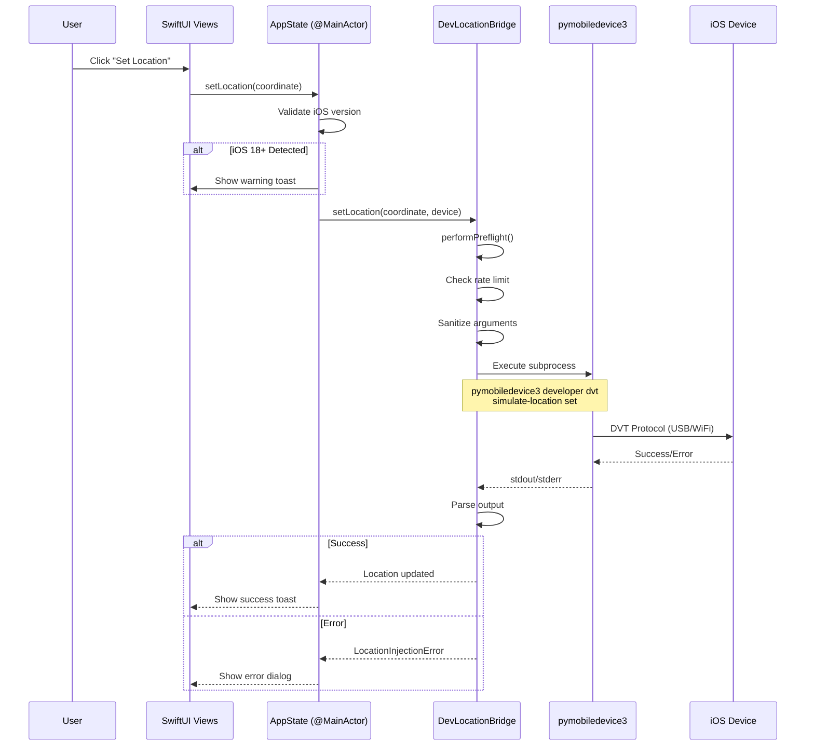

# PathChanger

**GPS Location Simulation for iOS 17+ Devices**

[](https://www.apple.com/macos/)
[](https://www.apple.com/ios/)
[](https://swift.org)
[](Tests/PathChangerTests/)
[](LICENSE)

**Status:** Recovered PathChanger baseline derived from the original LocationSpoofer project.

PathChanger is a macOS application for simulating GPS locations on iOS 17+ devices. Built with SwiftUI and powered by `pymobiledevice3`, it provides a native interface for teleport, route playback, and joystick-style location workflows.

PathChanger is a clean renamed recovery derived from `abyssbugg/LocationSpoofer` at commit `e8aa39f20a4b0e078245282967b8c9c791350f10`. See `NOTICE.md` for attribution and license provenance.

---

## ✨ Features

- **🎯 Teleport Mode** - Instantly jump to any coordinates worldwide
- **🗺️ Route Playback** - Follow GPX routes with configurable speed
- **🕹️ Joystick Control** - Real-time location movement with keyboard/joystick
- **🔌 Multi-Mode Tunnel** - USB, WiFi, Background Daemon, or Auto mode
- **⚡ Rate Limiting** - Token bucket algorithm (5 req/sec sustained)
- **🏥 Health Monitoring** - Dependency, tunnel, and device-status checks with recovery guidance
- **🔒 Security** - Input validation, injection prevention, sanitization
- **✅ Recoverable Build** - SwiftPM debug/release builds and local app-bundle packaging are part of the recovery verification flow

---

## 📦 Installation

### Option 1: Build from Source (Recommended)

```bash
# Clone the repository
git clone <new-pathchanger-repository-url>
cd PathChanger
# Build a durable app bundle at dist/PathChanger.app
./build.sh

# Install to the canonical Applications target
./install.sh

# Launch the newly installed app
open /Applications/PathChanger.app
```
`install.sh` installs `dist/PathChanger.app` to `/Applications/PathChanger.app`.

### Option 2: Download Pre-Built App

1. Download the latest `PathChanger-<version>-macOS.zip` and `PathChanger-<version>-macOS.sha256` from Releases.
2. Verify integrity locally:
   ```bash
   shasum -a 256 -c PathChanger-<version>-macOS.sha256
   ```
3. Unzip and move `PathChanger.app` into `/Applications/PathChanger.app`.
4. Launch from Applications or Spotlight.

---

## 🚀 Quick Start

### Prerequisites

**Required:**
- macOS 14.0 (Sonoma) or later
- Python 3.9 or later
- iOS device with iOS 17.0 or later
- USB cable (for initial setup)

**Install Python Dependencies:**
```bash
# Install the approved pymobiledevice3 pin (PC-G-001 — do not use unconstrained -U)
python3 -m pip install -r requirements-pathchanger.txt

# Verify installation (must match pin exactly)
python3 -m pymobiledevice3 version  # Expect 9.12.0
```

### First Run

1. **Enable Developer Mode on iOS:**
   - Settings → Privacy & Security → Developer Mode → ON
   - Device will reboot - confirm "Turn On Developer Mode"

2. **Launch PathChanger:**
   - Open `PathChanger.app` from Applications
   - Grant permissions if prompted

3. **Complete Onboarding:**
   - App will guide you through 4 validation steps
   - Checks Python 3.9+, pymobiledevice3, device connection, tunnel

4. **Connect Device:**
   - Plug in iOS device via USB
   - Click "Refresh Devices" in sidebar
   - Device should appear in device list

5. **Start Tunnel:**
   - Click "Start Tunnel" button
   - Wait for "Connected" status (green indicator)

6. **Teleport Your First Location:**
   - Select "Teleport" mode from sidebar
   - Click on map or enter coordinates:
     - Latitude: `35.6812`
     - Longitude: `139.7671` (Tokyo Station)
   - Click "Teleport Now"
   - Open Maps on iOS device - you're now in Tokyo! 🗼

---

## 📖 Usage

### Teleport Mode

Instantly jump to any location worldwide:

1. Select **Teleport** from sidebar
2. Choose method:
   - **Click on map** at desired location
   - **Enter coordinates** manually
   - **Use quick locations** (pre-configured landmarks)
3. Click **Teleport Now**
   - PathChanger sends a location update request to the connected device

**Quick Locations Included:**
- Tokyo Station (Japan)
- Times Square, NYC (USA)
- Eiffel Tower (France)
- Sydney Opera House (Australia)
- Big Ben (London, UK)

### Route Mode

Follow a pre-defined path from GPX files:

1. Select **Route** from sidebar
2. Click **Load GPX** and select file
3. Set playback speed (1-50 m/s)
4. Click **Start Route**
5. Route plays back with natural movement

Import GPX routes exported from Strava, Google Maps, or other route tools.

### Joystick Mode

Real-time movement control:

1. Select **Joystick** from sidebar
2. Use controls:
   - **Arrow Keys** - Move in cardinal directions
   - **Speed Slider** - Adjust movement speed (1-50 m/s)
   - **On-Screen Joystick** - Click and drag for movement
3. Location updates continuously while moving

---

## ⌨️ Keyboard Shortcuts

PathChanger supports extensive keyboard shortcuts for efficient operation:

### Location Commands

| Shortcut | Action |
|----------|--------|
| `⌘L` | Set location at current coordinates |
| `⌘K` | Clear current location |
| `⌘R` | Refresh device list |

### Simulation Commands

| Shortcut | Action |
|----------|--------|
| `⌘Space` | Start simulation |
| `⌘P` | Pause simulation |
| `⌘Esc` | Stop simulation |

### Navigation

| Shortcut | Action |
|----------|--------|
| `⌘\` | Toggle sidebar |
| `⌘,` | Open settings |

> **Tip:** A complete shortcuts reference is also available in Settings → Keyboard Shortcuts.

---

## ⚙️ Configuration

### Tunnel Modes

PathChanger supports 4 tunnel connection modes:

| Mode | Description | Use Case |
|------|-------------|----------|
| **Auto** | Automatically selects best method | Recommended default |
| **USB (Lockdown)** | Direct USB connection | Fastest (<30ms latency) |
| **WiFi** | Wireless connection via same network | No cable needed |
| **Daemon** | Background service, auto-discovery | Persistent connection |

**Change Mode:**
Settings → Tunnel Mode → Select preferred mode

### Rate Limiting

Prevents device/network overload:
- **Burst:** 10 requests (immediate)
- **Sustained:** 5 requests/second
- **Auto-throttle:** Queues excess requests

Customize in Settings → Advanced → Rate Limits

---

## 🧪 Testing

### Run Unit Tests

```bash
cd PathChanger
swift test
```

**Local test environment note:**
The XCTest suite requires full Xcode. Apple Command Line Tools alone do not provide `xctest` or `XCTest.framework`, so `swift test` cannot run in a CLT-only environment.

GitHub Actions runs the same test suite on a macOS runner with Xcode installed, so CI is the recommended XCTest source of truth when developing locally with Command Line Tools only.

**Test Suites:**
- `ArgumentSanitizerTests` - Input validation
- `GPXParserTests` - Route parsing
- `LocationCoordinateTests` - Coordinate validation
- `PythonPathResolverTests` - Dependency detection
- `RateLimiterTests` - Token bucket algorithm
- `RouteInterpolatorTests` - Route interpolation
- `TunneldManagerTests` - Tunnel lifecycle

### User Acceptance Testing
Hardware-dependent workflows require a Mac with full Xcode, Python, `pymobiledevice3`, and a trusted iOS 17 device with Developer Mode enabled.

---

## 🛠️ Development

### Build from Source

```bash
# Clone repository
git clone <new-pathchanger-repository-url>
cd PathChanger

# Build debug version
swift build

# Build release version
swift build -c release
# Create and sanitize app bundle in dist/
./build.sh

# Optional: install as side-by-side app (default)
./install.sh
```

### Project Structure

```
PathChanger/
├── PathChanger/           # Main app source
│   ├── UI/                    # SwiftUI views
│   ├── Core/                  # Services (RateLimiter, Logger, etc.)
│   ├── Device/                # Device communication & tunnel mgmt
│   ├── Models/                # Data models
│   ├── Simulation/            # Simulation engine
│   ├── GPX/                   # GPX parsing & route library
│   └── PathChangerApp.swift
├── Tests/                     # XCTest suite
├── Resources/                 # App resources
│   └── Info.plist
├── build.sh                   # Canonical app build entrypoint (writes dist/PathChanger.app)
├── install.sh                 # Installer for /Applications/PathChanger.app
├── build-app-bundle.sh        # Lower-level app bundler invoked by build.sh
├── dist/                      # Durable build artifacts (gitignored)
└── Package.swift              # Swift Package manifest
```

### Architecture

PathChanger is a monolithic SwiftUI macOS app with integrated backend:

- **UI Layer** - SwiftUI views with @ObservableObject state management
- **Service Layer** - Core services (RateLimiter, TunneldManager, etc.)
- **Device Layer** - pymobiledevice3 bridge, tunnel management
- **Data Layer** - Models, GPX parsing, coordinate validation

**No separate frontend/backend** - all communication happens through `@Published` properties for optimal performance.

### Data Flow Architecture




### API Documentation (DocC)

DocC generation is currently disabled in CI until a runner/toolchain combination with accessible DocC support is configured. The "Build Documentation" job in [CI workflow](.github/workflows/ci.yml) now validates the documentation stage without invoking DocC generation.

When documentation publishing is re-enabled, keep it as a separate CI change and verify the toolchain before restoring hosted documentation deployment.

---

## 🔒 Security

PathChanger implements multiple security layers:

- **Input Sanitization** - All coordinates, UDIDs, ports validated
- **Command Injection Prevention** - Subprocess arguments escaped
- **Path Traversal Protection** - File paths sanitized
- **Rate Limiting** - Prevents abuse and device overload
- **Process Timeout** - 30s max for all subprocess operations

Current safeguards focus on validating user/device input before invoking `pymobiledevice3` and avoiding shell-string command construction where possible.

---

## 📊 Performance

These are upstream target metrics and must be revalidated with PathChanger on target hardware before release claims are made:

| Metric | Target |
|--------|--------|
| Location Update Latency | <50ms |
| Tunnel Start Time | <15s |
| Rate Limit (sustained) | 5 req/s |
| Memory Usage (30min) | <150MB |
| CPU Usage (avg) | <20% |

---

## 🚧 Troubleshooting

### Common Issues

**1. "Tunnel failed to start"**

Check Python and dependencies:
```bash
python3 --version  # Should be >= 3.9
python3 -m pip install -r requirements-pathchanger.txt
python3 -m pymobiledevice3 version  # Expect 9.12.0
```

**2. "Device not detected"**

- Ensure Developer Mode is enabled on iOS device
- Unplug and reconnect USB cable
- Click "Refresh Devices" in sidebar
- Check `pymobiledevice3 usbmux list` in Terminal

**3. "Location not updating in some apps"**

- Some apps use cellular/GPS instead of network location
- **Fix:** Enable Airplane Mode + WiFi only on iOS device

**4. macOS Full Disk Access required**

System Settings → Privacy & Security → Full Disk Access → Enable for PathChanger

**5. "Operation not permitted" error**

- **Cause:** macOS security restrictions
- **Fix:** Grant PathChanger Full Disk Access (see #4)

**6. iOS 18+ Compatibility Issues**

PathChanger is optimized for iOS 17.0-17.6. **iOS 18+ devices may experience location injection failures** due to Apple's changes to the DVT (Developer Tools) service.

**Symptoms:**
- Diagnostics show the DVT/developer service is reachable, but actual location injection can still fail on affected iOS builds
- Location injection appears to succeed but device location doesn't change
- No clear error messages in logs

**Root Cause:**
Apple modified the `simulate-location` service in iOS 18+, causing pymobiledevice3 to fail silently. This is tracked in [pymobiledevice3 issue #1387](https://github.com/doronz88/pymobiledevice3/issues/1387).

**Solutions:**

*Option 1: Downgrade to iOS 17.6 (Recommended)*
1. Download iOS 17.6 IPSW from [ipsw.me](https://ipsw.me)
2. Connect device via USB
3. Open Finder → Select device
4. Hold Option (⌥) and click "Restore iPhone"
5. Select downloaded IPSW file
6. Wait for restore to complete (~15-30 minutes)

*Option 2: Debug pymobiledevice3 Directly*
```bash
# Test location injection with verbose logging
python3 -m pymobiledevice3 --debug developer dvt simulate-location set \
  --tunnel YOUR_DEVICE_UDID -- 35.6762 139.6503

# Check for specific errors:
# - InvalidServiceError: Service not available
# - DeveloperModeError: Developer mode disabled
# - ServiceNotAvailableError: iOS 18+ restriction
```

*Option 3: Check for Updates*
```bash
# Reinstall the approved pin (prefer requirements file over open-ended upgrade)
python3 -m pip install -r requirements-pathchanger.txt

# Verify version (check if > 6.1.5 has iOS 18 fixes)
python3 -m pymobiledevice3 version
```

**Detection in App:**
PathChanger automatically detects iOS 18+ devices and displays:
- ⚠️ Warning badge in device list
- Warning banner in main view
- Pre-injection warning toast
- Detailed error dialog with recovery steps

**Note:** This is a limitation of pymobiledevice3/Apple's DVT service, not a bug in PathChanger. Monitor the [pymobiledevice3 GitHub](https://github.com/doronz88/pymobiledevice3) for updates.

### Debug Logs

View logs in Console.app:
```
Filter: com.pathchanger
```

Or check tunnel logs:
```bash
tail -f ~/Library/Logs/PathChanger/tunnel.log
```

Run Diagnostics performs non-mutating readiness checks by default; it does not set a test coordinate on the device. Use the simulation controls to verify device location changes.

---

## 🔮 Future Enhancements

The following items are planned or deferred work and should be implemented only after the recovered baseline remains buildable and testable.

### Planned Features

**Priority 1: Multi-Device Support** (Est: 26h)
- Simultaneous spoofing on multiple devices
- Independent or synchronized modes
- Per-device rate limiting

**Priority 2: CI/CD Integration** (Est: 15h)
- GitHub Actions pipeline
- Automated testing and release validation
- ZIP + SHA256 packaging for GitHub releases

**Priority 3: Advanced Route Simulation** (Est: 160h)
- Physics-based movement (acceleration, friction)
- Behavioral modes (walking, running, driving, cycling)
- Environmental factors (elevation, terrain, weather)
- Route recording from real GPS

**Additional Ideas:**
- AR Map View (3D terrain visualization)
- Location History & Favorites
- Geofencing (stay-within boundaries)
- Scripting Support (JavaScript/Python automation)
- Cloud Sync (routes across devices)

---

## 🤝 Contributing

Contributions are welcome! Please see [CONTRIBUTING.md](CONTRIBUTING.md) for guidelines.

**Good First Issues:**
- Add more preset locations
- Create sample GPX routes
- UI/UX improvements
- Performance optimizations
- Documentation translations

**Development Workflow:**
1. Fork the repository
2. Create feature branch (`git checkout -b feature/amazing-feature`)
3. Commit changes (`git commit -m 'Add amazing feature'`)
4. Push to branch (`git push origin feature/amazing-feature`)
5. Open Pull Request

---

## 📄 License

MIT License - see [LICENSE](LICENSE) file for details.

---

## 🙏 Acknowledgments

- [pymobiledevice3](https://github.com/doronz88/pymobiledevice3) - iOS device communication
- [doronz88](https://github.com/doronz88) - RemoteXPC protocol research
- Swift & SwiftUI community

---

## 📞 Support

- **Issues:** configure after the new PathChanger repository is created.
- **Discussions:** configure after the new PathChanger repository is created.

---

## ⭐ Star History

If you find this project useful, please consider giving it a star! ⭐

---

**Made with ❤️ for iOS developers and testers**
