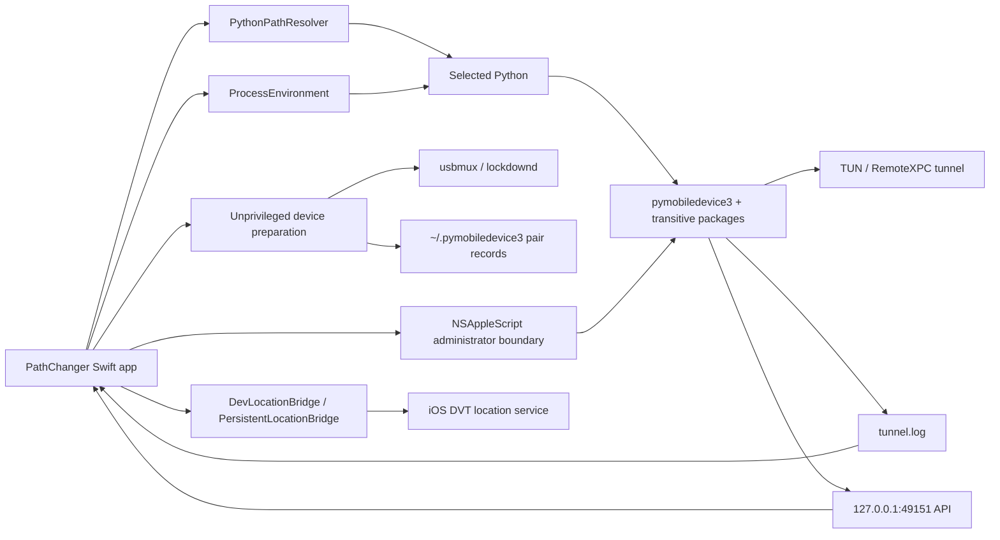

# Phase 2 — Tunnel Dependencies and Integrations Audit

## Scope

This audit covers dependencies and integrations that participate in the tunnel
lifecycle:

- Swift/build dependencies,
- Python interpreter selection,
- pymobiledevice3 installation and CLI contracts,
- USB/Wi-Fi/RemotePairing integrations,
- privileged process execution,
- tunnel output and HTTP API contracts,
- health/process observation,
- DVT location consumers,
- signing, entitlements, and packaging behavior.

It is read-only with respect to application behavior.

## Executive summary

The tunnel subsystem depends on much more than one Python package. Its behavior
is determined by a chain of coupled choices:

1. `PythonPathResolver` chooses one fixed-path interpreter.
2. pymobiledevice3 must be installed for that exact interpreter.
3. privileged execution must see the same selected-interpreter package tree and
   user pairing records.
4. the selected pymobiledevice3 version must expose the expected CLI and Python
   APIs.
5. tunnel output must match PathChanger's parser.
6. the selected tunnel protocol and OS networking services must work.
7. `DevLocationBridge` or `PersistentLocationBridge` must use a compatible
   connection route.

Live audit state:

- selected interpreter: `/opt/homebrew/bin/python3.13`
- Python: `3.13.15`
- pymobiledevice3: `10.7.4`
- installation:
  `/opt/homebrew/lib/python3.13/site-packages`
- pairing records:
  `~/.pymobiledevice3`
- tunneld API default:
  `127.0.0.1:49151`
- current API reachability during audit: not running

The most important findings are:

1. The app declares pymobiledevice3 `6.1.5` as sufficient, but the code depends
   on substantially newer 10.x command/API behavior.
2. The selected Homebrew interpreter and package tree are user-owned but run as
   root; elevated `HOME` also exposes user pairing records.
3. The installer upgrades to unpinned latest, so a working release can silently
   move to an incompatible CLI/API.
4. PathChanger parses human-formatted tunnel logs even though pymobiledevice3
   provides `--script-mode` specifically for stable HOST/PORT output.
5. Current pymobiledevice3 documentation says iOS 17.4+ developer commands
   default to no-root in-process userspace tunnels. PathChanger still models a
   privileged external tunnel as generally required.
6. The high-frequency persistent Python bridge does not implement
   `UserspaceRsdTunnel`, so its dependency requirements differ from one-shot
   CLI injection.
7. Development and packaged builds acquire `location_bridge.py` through
   different paths.

## Dependency inventory

### Swift package dependencies

File: `Package.swift`

External Swift dependency:

- Sparkle `2.8.1`, pinned exactly.

Sparkle is not in the tunnel call path. It affects application launch,
packaging, signing, and update distribution, but tunnel functionality should
not depend on it.

Internal platform requirements:

- Swift tools `5.9`
- macOS `14+`

### macOS frameworks and system services

#### Foundation

Used for:

- `Process`
- `Pipe`
- `FileHandle`
- `URLSession`
- filesystem/log access
- UserDefaults

#### Combine

Used to propagate:

- tunnel-state changes,
- device-state changes,
- health/readiness changes.

#### AppKit

Used for:

- `NSAppleScript`
- administrator prompt lifecycle
- app termination notifications.

#### Darwin

Used for:

- `kill(pid, 0)` process existence checks.

#### macOS device/network services

Reached indirectly through pymobiledevice3:

- usbmuxd / MobileDevice USB and Network records,
- lockdownd,
- CoreDeviceProxy,
- RemotePairing,
- RemoteXPC,
- Bonjour/mDNS,
- TUN/TAP interfaces,
- macOS network interfaces.

These are runtime integrations, not linked Swift dependencies.

### Python interpreter

File: `PathChanger/Core/PythonPathResolver.swift`

Resolution is fixed-path and first-match:

1. Homebrew unversioned Python,
2. Homebrew 3.14/3.13/3.12,
3. `/usr/local` equivalents,
4. `/usr/bin/python3`.

Deliberately unsupported:

- pyenv shims,
- virtual environments,
- user-local executable paths.

Live result:

- unversioned Homebrew Python was absent,
- `/opt/homebrew/bin/python3.13` exists and is the first executable candidate,
- the path is a user-owned symbolic link,
- resolved version: Python `3.13.15`.

### pymobiledevice3

Declared minimum:

- `6.1.5`

Live installation:

- version `10.7.4`
- installed in the user-owned Homebrew site-packages tree.

Selected transitive dependencies reported by pip include:

- `pmd-pytcp`
- `pytun-pmd3`
- `qh3`
- `cryptography`
- `fastapi`
- `uvicorn`
- `pyusb`
- `ifaddr`
- `psutil`
- `requests`
- `typer`
- `construct`
- `opack2`
- `sslpsk-pmd3`

The full dependency set is large and currently unpinned by PathChanger.

### Python installer integration

Files:

- `PathChanger/Core/PythonPathResolver.swift`
- `PathChanger/Core/DependencyValidator.swift`

Install behavior:

- runs `python -m pip install --upgrade pymobiledevice3`
- adds `--user` for Apple Python,
- adds `--break-system-packages` for Homebrew Python,
- installs latest,
- has no maximum version,
- has no lockfile/hash,
- validates only that the version is at least `6.1.5`.

This is runtime dependency mutation, not a build-time pinned dependency.

## Installed compatibility verification

### Python compatibility

Current upstream documentation states:

- Python `>=3.9` for userspace tunnels.

The resolver-selected Python `3.13.15` satisfies that requirement.

### CLI compatibility

The installed pymobiledevice3 `10.7.4` supports the commands PathChanger uses.

#### `lockdown start-tunnel`

Verified options:

- `--script-mode`
- `--udid`
- `--userspace`
- `--mobdev2`
- `--rsd`
- `--tunnel`

#### `remote start-tunnel`

Verified options:

- `-t/--connection-type usb|wifi`
- `--udid`
- `--script-mode`
- `--protocol tcp|quic`
- `--max-idle-timeout`

#### `remote tunneld`

Verified defaults:

- host `127.0.0.1`
- port `49151`
- USB enabled
- Wi-Fi enabled
- usbmux enabled
- mobdev2 enabled

This matches `AppConstants.Tunnel.tunneldAPIEndpoint`.

### Protocol behavior changes by interpreter

Installed CLI help reports:

- Python below 3.13 defaults to QUIC.
- Python 3.13+ defaults to TCP.

Current interpreter:

- Python 3.13 → TCP path.

If candidate availability changes and the resolver falls back to Apple Python
3.9, the tunnel protocol can silently change from TCP to QUIC because
PathChanger does not pass `--protocol`.

The selected interpreter can therefore change:

- package environment,
- tunnel implementation,
- networking behavior,
- output behavior,
- transitive dependency use.

## Integration boundary map

## Command and integration contracts

### Device discovery

#### usbmux

Command:

- `python -m pymobiledevice3 usbmux list`

Contract consumed:

- JSON array,
- `ConnectionType`,
- `UniqueDeviceID`,
- `Identifier`.

### Bonjour mobdev2

Command:

- `python -m pymobiledevice3 bonjour mobdev2`
- pairing records path explicitly passed.

Contract consumed:

- JSON records,
- endpoint identifiers can be IPv4/IPv6 rather than UDID.

### Wi-Fi preparation

Commands:

1. `lockdown wifi-connections --state on --udid <UDID>`
2. `lockdown remotepairing --pair --udid <UDID>`

Execution:

- unprivileged,
- requires a trusted matching USB device,
- writes RemotePairing data for later Wi-Fi use.

### Pairing-record storage

Current user store contains:

- standard UDID plist,
- `remote_<UDID>.plist`.

`DeviceManager` reads only filenames when discovering known remote-paired
devices.

Privileged tunnel launch preserves the user's `HOME` so elevated
pymobiledevice3 resolves user RemotePairing records.

The resolver-selected pymobiledevice3 package itself is loaded from the
user-owned Homebrew site-packages tree.

### Privileged tunnel commands

Allowed:

- `lockdown start-tunnel [--udid <UDID>]`
- `remote start-tunnel -t wifi [--udid <UDID>]`
- `remote tunneld`

Boundary:

- exact Python path allowlist,
- exact argv allowlist,
- validated UDID suffix,
- path quoting,
- PID-only stop.

### Tunnel output contract

Current implementation:

- redirects stdout/stderr to `~/Library/Logs/PathChanger/tunnel.log`,
- scans human-formatted text,
- recognizes:
  - `--rsd HOST PORT`,
  - structured `RSD Address` / `RSD Port`,
  - selected JSON forms,
  - error substrings.

Installed CLI supports:

- `--script-mode`, explicitly documented to output only HOST and port.

PathChanger does not use it.

### tunneld HTTP API

Configured endpoint:

- `http://127.0.0.1:49151/`

Appropriate only for:

- `remote tunneld`.

One-shot modes:

- `lockdown start-tunnel`
- `remote start-tunnel`

do not provide this daemon API. Query failures in those modes are expected and
should not be logged as unexplained tunnel failures.

### Process detection

PathChanger uses `pgrep -f` with broad patterns:

- `pymobiledevice3 lockdown start-tunnel`
- `pymobiledevice3 remote start-tunnel`
- `pymobiledevice3 remote tunneld`

This can detect:

- processes launched outside PathChanger,
- processes from another Python interpreter,
- processes with incompatible device/mode,
- stale processes without usable endpoints.

Adoption adds endpoint validation, but initial process detection is not scoped
to PathChanger ownership.

## DVT/location integrations

### Standard `DevLocationBridge`

Uses pymobiledevice3 CLI:

- DVT preflight,
- simulate-location set/clear,
- connection flags selected at runtime.

Connection choices:

- RSD endpoint,
- daemon tunnel,
- direct UDID.

Current upstream behavior:

- iOS 17.4+ developer commands can automatically create an in-process
  userspace tunnel when no explicit RSD/tunneld route is passed.

Implication:

- one-shot CLI injection does not always require an external privileged
  tunnel.

### Persistent bridge

Files:

- `PathChanger/Device/PersistentLocationBridge.swift`
- `scripts/location_bridge.py`

Purpose:

- reuse one Python process and DVT service for high-frequency route/joystick
  updates.

Connection behavior:

- with RSD host/port:
  `RemoteServiceDiscoveryService`,
- without RSD:
  `create_using_usbmux` plus direct DVT service.

It does not use:

- `UserspaceRsdTunnel`,
- CLI automatic userspace tunnel setup.

Implication:

- the persistent bridge still depends on an external RSD tunnel for modern DVT
  flows where direct lockdown DVT is unavailable.
- standard and performance modes have different hidden tunnel requirements.

### Persistent bridge resource integration

Swift package resources do not list:

- `scripts/location_bridge.py`.

XcodeGen resources do not list it either.

The manual app-bundle script copies it explicitly.

`PersistentLocationBridge` searches:

1. bundled `location_bridge.py`,
2. `<current working directory>/scripts/location_bridge.py`,
3. a relative executable resources path.

Consequences:

- packaged manual build can include it,
- development runs can succeed only because working directory points at the
  repository,
- another Xcode/FlowDeck/run context can fail to find it,
- tests can validate behavior under a different resource layout than release.

## Upstream userspace-tunnel integration

Current upstream pymobiledevice3 documentation states:

- iOS 17.4+ developer commands default to no-root in-process userspace tunnels.
- privileged tunneld remains useful for:
  - external tools,
  - a shared persistent tunnel,
  - older iOS 17.0–17.3.1 behavior.
- `--userspace` explicitly forces that route.

PathChanger targets iOS 27 in the current hardware scenario.

Architectural conclusion:

- **Teleport/one-shot CLI operations** can potentially use the no-root
  userspace path.
- **Persistent route/joystick operations** currently do not implement the
  userspace Python API and still benefit from or require a shared RSD tunnel.
- The GUI should not present one universal “tunnel required” rule without
  distinguishing the requested operation and connection implementation.

This is an audit finding, not yet an implementation decision. End-to-end GUI
verification is still required before changing the tunnel requirement.

## Environment and security integration

### Process environment

`ProcessEnvironment.configured()`:

- restricts PATH,
- removes `PYTHONPATH`,
- removes `PYTHONHOME`,
- removes virtual-environment markers,
- removes `PIP_*`,
- retains other environment values.

Unprivileged processes use this environment.

Elevated tunnel command:

- uses an absolute Python path,
- explicitly prefixes `HOME=<user home>`,
- otherwise executes in `do shell script` environment.

The two environments are not identical.

### Alternate-interpreter TLS/SSL warning

Apple Python 3.9 uses LibreSSL `2.8.3` and emits urllib3's
`NotOpenSSLWarning` when pymobiledevice3 is invoked through that interpreter.
It is not the current resolver-selected runtime, but a candidate-set change
could activate this warning and different package/protocol behavior.

### Entitlements and sandbox

Relevant entitlements include:

- network client,
- network server,
- USB,
- Bluetooth,
- user-selected files.

No `com.apple.security.app-sandbox` entitlement is present.

The Xcode wrapper and manual bundle script sign with the entitlements file.
Production signing adds hardened runtime.

### AppleScript privilege integration

Info.plist contains:

- `NSAppleEventsUsageDescription`.

Tunnel start/stop uses:

- `NSAppleScript`,
- `do shell script ... with administrator privileges`.

This is a runtime OS integration and a known future replacement target for a
typed privileged helper.

## Build and deployment integration

### Xcode/FlowDeck build

- builds from Xcode wrapper,
- uses project resources,
- launches from DerivedData,
- must not overwrite installed app.

### Manual bundle script

`build-app-bundle.sh`:

- runs Swift build,
- copies Sparkle,
- copies `location_bridge.py`,
- signs bundle,
- then unconditionally deletes and replaces
  `/Applications/PathChanger.app`,
- deletes the staging app,
- sweeps FlowDeck/private-tmp PathChanger app products.

This script is incompatible with the current requirement that dev/test builds
must not overwrite the installed app.

It also makes the bridge-resource behavior differ from FlowDeck.

## Strengths

### TUN-DEP-S1 — Fixed Swift dependency pin

Sparkle is exactly pinned across SwiftPM/XcodeGen.

### TUN-DEP-S2 — Fixed Python executable policy

The app does not execute arbitrary PATH-resolved Python.

### TUN-DEP-S3 — Hardened subprocess environment

Python and pip override variables are removed.

### TUN-DEP-S4 — Strict privileged argv allowlist

Only defined tunnel commands and validated UDIDs may cross the elevated shell
boundary.

### TUN-DEP-S5 — User pairing-record preservation

Elevated execution deliberately preserves user `HOME`, addressing root/user
pairing-record divergence.

### TUN-DEP-S6 — Local-only tunneld API default

The configured daemon API binds loopback by default and matches upstream CLI.

### TUN-DEP-S7 — Usable endpoint required

Port zero or missing host cannot produce active state.

## Findings and risks

### TUN-DEP-01 — User-owned interpreter/package tree executed as root

Severity: Critical

Evidence:

- selected interpreter path is a user-owned Homebrew symlink,
- Homebrew prefix and pymobiledevice3 package tree are user-owned,
- the command executes this code with administrator privileges,
- preserved user `HOME` also supplies RemotePairing records.

Failure mode:

- user-writable Python/package code executes as root after approval,
- an update or mutation can make unprivileged validation and privileged launch
  behave differently,
- pairing-record changes can redirect or break the privileged session.

Required direction:

- never elevate a user-writable interpreter/package tree,
- use a root-owned typed helper or root-owned verified runtime,
- pass pairing material through a narrow typed interface instead of exposing
  user HOME to elevated Python.

### TUN-DEP-02 — Declared minimum version does not match assumed API

Severity: High

Declared:

- pymobiledevice3 `6.1.5`.

Used behavior:

- modern `remote start-tunnel -t wifi --udid`,
- lockdown RemotePairing bootstrap,
- userspace options,
- current DVT and Python service APIs.

Required direction:

- define a tested supported version interval,
- validate required command options/API imports, not only semantic version.

### TUN-DEP-03 — Unpinned runtime upgrade

Severity: High

The GUI installs:

- latest pymobiledevice3,
- no upper bound,
- no hash/lockfile.

Failure mode:

- CLI flags, output, import paths, or protocol defaults can change without an
  app release.

Required direction:

- pin a tested version/range,
- verify schema after installation,
- make upgrade explicit and reversible.

### TUN-DEP-04 — Human log parsing instead of script contract

Severity: High

Both manual start commands support:

- `--script-mode`.

PathChanger parses formatted text and warning-contaminated stderr instead.

Failure mode:

- harmless upstream formatting or warning changes prevent endpoint detection,
- process remains alive but app times out and reports failure.

Required direction:

- launch with `--script-mode`,
- keep stdout and stderr separate,
- parse the exact HOST/PORT record,
- use stderr only for diagnostics.

### TUN-DEP-05 — Userspace tunnel capability not modeled

Severity: Medium-High

Current upstream default:

- no-root userspace tunnel for iOS 17.4+ developer commands.

PathChanger:

- still presents privileged tunnel as generally required,
- does not distinguish one-shot CLI from persistent Python bridge capability.

Required direction:

- define connection capabilities per operation,
- verify userspace Teleport through GUI,
- either implement `UserspaceRsdTunnel` in the persistent bridge or retain a
  clearly scoped persistent-tunnel requirement.

### TUN-DEP-06 — Persistent bridge resource differs by build path

Severity: High

The script is copied only by the manual bundle script and found from working
directory in development.

Required direction:

- declare `location_bridge.py` as a real target resource in SwiftPM and Xcode,
- resolve only from `Bundle`,
- test the built app resource.

### TUN-DEP-07 — Protocol changes with Python version

Severity: Medium

Current Python 3.13 defaults remote tunnel to TCP.
Apple Python 3.9 would default to QUIC.

Required direction:

- explicitly choose/test protocol,
- do not let interpreter discovery silently choose transport behavior.

### TUN-DEP-08 — Daemon API queried for non-daemon modes

Severity: Medium

One-shot tunnels do not expose `127.0.0.1:49151`.

Impact:

- repeated expected connection-refused logs,
- obscures the actual tunnel failure,
- encourages incorrect “tunneld API is down” diagnosis.

Required direction:

- query API only when active/requested mode is daemon,
- use log/script output for one-shot modes.

### TUN-DEP-09 — Broad process-pattern integration

Severity: Medium

`pgrep -f` can adopt unrelated or incompatible tunnel processes.

Required direction:

- prefer tracked PID/session metadata,
- validate owner, command, target UDID, mode, and endpoint before adoption,
- persist explicit session metadata if relaunch adoption is required.

### TUN-DEP-10 — Health integration measures process lookup

Severity: Medium

Current latency metric measures `/bin/ps`, not tunnel reachability.

Required direction:

- probe endpoint and a minimal RemoteXPC/DVT service,
- separate process health from session health.

### TUN-DEP-11 — Candidate fallback changes TLS and protocol stack

Severity: Low-Medium

Apple Python emits a LibreSSL warning and selects a different default tunnel
protocol than the current Homebrew Python.

Required direction:

- pin one supported managed interpreter and protocol,
- prevent alternate-interpreter warnings from contaminating machine-readable
  output.

### TUN-DEP-12 — Build script overwrites installed app

Severity: High operational risk

The manual bundle script deletes `/Applications/PathChanger.app` and cleans
other builds.

Required direction:

- separate build from install,
- make install explicit,
- never delete FlowDeck/test builds from a build command.

### TUN-DEP-13 — Onboarding reports placeholder dependency version

Severity: Low

The onboarding view assigns the minimum pymobiledevice3 version string rather
than reading the installed version.

Required direction:

- display the validated installed version.

### TUN-DEP-14 — Transitive Python graph is uncontrolled

Severity: Medium

pymobiledevice3 pulls networking, QUIC, crypto, web server, USB, image, and
interactive-shell packages with no PathChanger lock.

Required direction:

- use a locked environment with hashes,
- include dependency vulnerability scanning in release validation.

## Compatibility matrix

### Current local runtime

- macOS 14+ target: compatible
- Python 3.13.15: compatible with current upstream minimum
- pymobiledevice3 10.7.4: current command schemas verified
- current default tunnel protocol: TCP
- user RemotePairing record: present
- tunneld API: correctly unreachable while daemon is not running
- privileged runtime: user-owned Homebrew interpreter/package tree
- pairing discovery: dependent on preserved user HOME
- standard CLI userspace capability: available
- persistent bridge userspace capability: absent

### Build-path compatibility

- FlowDeck/Xcode: main app builds, bridge resource depends on working directory
- SwiftPM dev: bridge resource depends on repository working directory
- manual app bundle: bridge copied explicitly
- installed app: can contain bridge only when built through manual script

## Required integration tests

### Dependency tests

- selected interpreter matches validator/installer/elevated launcher,
- elevated interpreter can import pymobiledevice3,
- elevated interpreter can locate the intended RemotePairing record,
- required CLI options exist,
- required Python imports exist,
- unsupported versions fail before tunnel start.

### Output-contract tests

- script-mode stdout parses exactly,
- warnings on stderr do not affect endpoint parsing,
- process exit returns classified error,
- one-shot mode never queries daemon API,
- daemon mode validates API response schema.

### Build-resource tests

- `Bundle.main` contains `location_bridge.py`,
- bridge starts from a copied app outside the repository,
- installed app and dev app use identical bridge source/version.

### Userspace/persistent capability tests

- one-shot Teleport uses/forces userspace without admin on iOS 17.4+,
- route/joystick persistent bridge reports a clear need for RSD when required,
- userspace Python API implementation is tested before replacing persistent
  privileged tunnel behavior.

## Prioritized remediation sequence

1. Use `--script-mode`; separate stdout/stderr.
2. Query the HTTP API only for daemon mode.
3. Declare and bundle `location_bridge.py` consistently.
4. Raise and pin the supported pymobiledevice3 version/range.
5. Add interpreter/CLI/API capability preflight.
6. Pin protocol or model it explicitly.
7. Separate one-shot userspace capability from persistent tunnel capability.
8. Replace pgrep adoption with owned session metadata.
9. Replace process-only health with endpoint/service health.
10. Separate build and install scripts.
11. Move to an app-managed locked Python dependency environment.

## Audit conclusion

The installed tools are sufficient to run the current command shapes, but the
integration is not reproducible or robust enough for a professional tunnel
lifecycle.

The dominant issue is dependency identity:

> PathChanger does not currently guarantee that validation, installation,
> unprivileged discovery, privileged launch, and persistent bridge execution
> all use the same tested Python/pymobiledevice3 environment and connection
> capability.

Phase 1 lifecycle centralization and this Phase 2 dependency work must meet at a
typed capability preflight. A tunnel attempt should start only after the exact
interpreter, package version, command schema, pairing record, output contract,
and requested connection capability have been validated.
