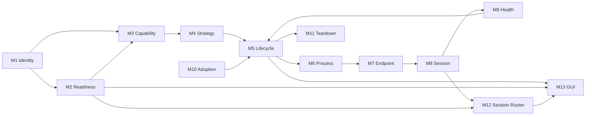

# Phase 3 — Tunnel Functional Modules and Data Flows

## Purpose

This document defines the functional modules and scenario-level data flows for
the tunnel lifecycle, based on:

- `Architecture-Note-Aug-23-2026.md`
- `Tunnel-Lifecycle-Architecture-Aug-23-2026.md`
- `Tunnel-Dependencies-Integrations-Audit-Aug-23-2026.md`

It documents current behavior and the verified target boundaries required for
USB, Wi-Fi, daemon, direct transport, adoption, health, and teardown flows.

No tunnel behavior is implemented by this document.

## Functional domain model

The tunnel domain is composed of six separate facts:

1. **Identity** — which canonical physical iOS device is targeted.
2. **Capability** — which tunnel/direct connection mechanisms the installed
   runtime supports.
3. **Readiness** — which direct transports are currently available.
4. **Lifecycle** — whether a tunnel attempt/session is idle, starting, active,
   degraded, reconnecting, failed, or stopping.
5. **Route** — how a DVT command reaches the selected device.
6. **Simulation** — the feature state being transported.

These facts currently overlap across several classes. The functional modules
below define the intended separation.

## Module M1 — Canonical Device Target Resolution

### Purpose

Resolve all discovery identifiers to one stable UDID before starting a tunnel
or issuing a DVT command.

### Current implementation

- `DeviceManager.deduplicatePhysicalDevices`
- `AppState.tunnelTargetDeviceId`
- `DevicePreparationPlanner.remotePairingDeviceId`
- `ArgumentSanitizer.isValidDeviceUDID`

### Inputs

- selected `Device`,
- canonicalized available devices,
- pairing-record filenames,
- last prepared UDID.

### Outputs

- canonical UDID,
- explicit failure when no unambiguous UDID exists.

### Current gaps

- `AppState.tunnelTargetDeviceId` can return the selected raw identifier as a
  final fallback.
- The target is not carried as a typed identity through every later event.
- `SettingsView` starts the manager directly without using this resolver.

### Target contract

Input:

- `SelectedDeviceIdentity`

Output:

- `Result<CanonicalDeviceID, TargetResolutionFailure>`

No downstream module may accept an IP address or source-local identifier where
a UDID is required.

## Module M2 — Transport Readiness Observation

### Purpose

Report whether the canonical device is directly reachable through:

- USB,
- Wi-Fi/Network,
- both,
- neither.

### Current implementation

- `DeviceManager.applyUsbmuxTransportObservation`
- `DeviceManager.usbDirectDeviceIds`
- `DeviceManager.wifiDirectDeviceIds`
- `DeviceStateManager.selectedDirectTransportAvailable`
- aggregate USB/Wi-Fi booleans.

### Inputs

- usbmux JSON,
- canonical UDID,
- Bonjour observations,
- selected device.

### Outputs

- per-device USB readiness,
- per-device Wi-Fi readiness,
- aggregate readiness booleans.

### Current gaps

- no same-network state,
- no “both ready” first-class state,
- no fallback capability,
- one `Device.connectionType` cannot represent both,
- readiness is copied into multiple GUI-facing properties.

### Target contract

Output:

- `TransportReadinessSnapshot`
  - canonical UDID,
  - available transports,
  - same-network status,
  - preferred transport,
  - fallback availability,
  - observation timestamps/sources.

This module never publishes tunnel-active state.

## Module M3 — Runtime Capability and Dependency Preflight

### Purpose

Prove that the selected runtime can execute the requested connection strategy
before moving lifecycle state to starting.

### Current implementation

- `PythonPathResolver`
- `DependencyValidator`
- `ProcessEnvironment`
- partial checks inside `TunneldManager.attemptStart`
- `PrivilegedTunnelCommand` validation.

### Inputs

- selected Python path,
- installed pymobiledevice3,
- requested mode,
- canonical UDID,
- transport readiness,
- pairing records,
- operation type (one-shot or persistent).

### Outputs

- verified capability,
- classified dependency/capability failure.

### Current checks

- Python executable exists,
- USB is visible for USB tunnel,
- command is allowlisted,
- UDID syntax is valid.

### Missing checks

- tested pymobiledevice3 version range,
- required CLI flags,
- required Python imports,
- elevated interpreter import visibility,
- elevated pairing-record visibility,
- persistent bridge resource presence,
- persistent bridge connection capability,
- protocol selection,
- same-network suitability for Wi-Fi.

### Target contract

Input:

- `TunnelRequest`
- `TransportReadinessSnapshot`

Output:

- `Result<VerifiedTunnelCapability, CapabilityFailure>`

The lifecycle must remain idle/failed when capability preflight fails.

## Module M4 — Tunnel Strategy Selection

### Purpose

Choose the connection strategy appropriate to:

- user preference,
- available transport,
- device/iOS capability,
- requested operation,
- dependency capability.

### Current implementation

- `DeviceManager.connectionMode`
- `TunneldManager.preferredMode`
- `TunneldManager.startTunnel`
- auto order: USB → Wi-Fi → daemon.

### Strategies

- direct USB/userspace command,
- direct Network/userspace command,
- USB lockdown one-shot tunnel,
- Wi-Fi RemotePairing one-shot tunnel,
- background `remote tunneld`.

### Current gaps

- user connection preference and tunnel strategy are coupled,
- auto mode ignores operation-specific userspace capability,
- no same-network input,
- no stability/failover input,
- no explicit protocol choice,
- one-shot and daemon success criteria are treated similarly.

### Target contract

Input:

- capability,
- readiness,
- requested operation,
- user preference,
- current session health.

Output:

- `ConnectionStrategy`
- explanation/decision trace.

## Module M5 — Lifecycle State Kernel

### Purpose

Own the only lifecycle state and enforce legal transitions.

### Current implementation

- `TunnelStateMachine`

### Current states

- idle,
- starting,
- running,
- stopping,
- error.

### Required states

- idle,
- starting,
- active,
- degraded,
- reconnecting,
- failed,
- stopping.

### Inputs

- explicit start/stop,
- capability result,
- process launch/exit,
- endpoint result,
- health result,
- retry result,
- adoption result.

### Outputs

- immutable lifecycle snapshot,
- typed side-effect requests.

### Current gaps

- no attempt/session generation ID,
- degraded health is external to lifecycle,
- reconnecting exists only as unused recovery fields/events,
- state/context are mirrored into manager properties,
- stale async completions are filtered by ad hoc state guards.

### Target contract

All lifecycle events carry:

- generation ID,
- canonical UDID,
- timestamp.

No other module publishes a tunnel-running boolean.

## Module M6 — Privileged Process Launch Adapter

### Purpose

Translate a verified tunnel strategy into exactly one privileged process and
report process facts back to the lifecycle kernel.

### Current implementation

- `PrivilegedTunnelCommand`
- `TunneldManager.runAdministratorShell`
- `TunneldManager.attemptStart`
- PID discovery and tracking.

### Inputs

- verified Python path,
- exact allowlisted arguments,
- log/output destination,
- attempt generation.

### Outputs

- launched PID,
- user cancellation,
- privilege/launch failure,
- process exit.

### Current strengths

- exact argv allowlist,
- validated target suffix,
- fixed Python paths,
- user HOME preservation,
- PID-only stop command.

### Current gaps

- `NSAppleScript` is the process boundary instead of a typed helper,
- output and error are merged into one file,
- a missing shell PID falls back to broad `pgrep`,
- no generation ID follows the process callback,
- elevated dependency preflight is missing.

### Target contract

Input:

- `VerifiedLaunchRequest`

Output events:

- `processLaunched(generation, pid)`
- `processExited(generation, pid, status, diagnostics)`
- `launchCancelled(generation)`
- `launchFailed(generation, failure)`

## Module M7 — Endpoint Acquisition and Validation

### Purpose

Obtain a usable RSD endpoint or daemon session route and prove it is usable.

### Current implementation

- `TunneldManager.parseRsdInfo`
- log parsing strategies,
- `TunneldManager.queryTunneldAPI`
- `TunnelStartupWaiter`.

### Inputs

- strategy/mode,
- process PID,
- stdout/stderr or daemon API response,
- canonical UDID.

### Outputs

- validated `TunnelInfo`,
- per-device daemon route,
- endpoint failure.

### Current one-shot behavior

- parse `--rsd` hint,
- parse formatted `RSD Address` / `RSD Port`,
- parse selected JSON,
- validate host and port,
- poll until endpoint, process exit, or timeout.

### Current daemon behavior

- launches `remote tunneld`,
- queries `127.0.0.1:49151`,
- `DeviceManager` parses daemon device keys,
- `TunneldManager.queryTunneldAPI` only validates/logs success and does not
  populate `deviceTunnelInfo`.

### Confirmed daemon integration gap

The manager declares per-device `deviceTunnelInfo`, but its API query does not
populate it. Startup still waits for a single `tunnelInfo`. A daemon can be
healthy without immediately emitting one device-specific RSD endpoint in the
same form as a one-shot tunnel.

The lifecycle success criteria for daemon mode are therefore not correctly
separated from one-shot mode.

### Target contract

One-shot output:

- `ValidatedRsdEndpoint`

Daemon output:

- `ValidatedDaemonSession`
  - API reachable,
  - target UDID present/absent,
  - per-device tunnel route.

Use:

- `--script-mode` for one-shot stdout,
- daemon API only for daemon mode,
- separate stderr diagnostics.

## Module M8 — Tunnel Session Publication

### Purpose

Publish the validated session that proves active state and can be consumed by
GUI and routing.

### Current implementation

- `TunnelStateMachine.context.tunnelInfo`
- `TunneldManager.tunnelInfo`
- `TunneldManager.deviceTunnelInfo`
- `TunneldManager.activeMode`
- Combine synchronization.

### Inputs

- validated endpoint/daemon session,
- PID,
- mode,
- canonical UDID.

### Outputs

- GUI lifecycle snapshot,
- immutable tunnel session for connection routing.

### Current gaps

- endpoint truth is duplicated,
- session is not one immutable object,
- active mode is not proof of actual transport,
- GUI can read state and endpoint from different update moments.

### Target contract

Output:

- `TunnelSession`
  - generation,
  - canonical UDID,
  - process ownership,
  - established transport,
  - endpoint/daemon route,
  - established timestamp.

The lifecycle can be active only while this object exists.

## Module M9 — Health Observation

### Purpose

Measure actual session health without deciding lifecycle policy.

### Current implementation

- `TunnelHealthMonitor`

### Inputs

- manager running state,
- `tunnelInfo`,
- PID.

### Current probe

- `/bin/ps -p <PID>`.

### Outputs

- healthy,
- degraded,
- critical,
- disconnected,
- process-command latency,
- USB fallback recommendation.

### Current gaps

- no endpoint reachability probe,
- no DVT/RemoteXPC service probe,
- latency is process lookup latency,
- degraded does not reach the lifecycle state,
- fallback recommendation has no router/failover consumer.

### Target contract

Input:

- immutable `TunnelSession`

Output:

- `TunnelHealthObservation`
  - process alive,
  - endpoint reachable,
  - minimal service reachable,
  - latency,
  - consecutive failure count,
  - reason.

Lifecycle/failover policy consumes the observation.

## Module M10 — Adoption and Reconciliation

### Purpose

Safely adopt a tunnel session that survived GUI relaunch.

### Current implementation

- `DeviceManager.checkTunneldStatus`
- `DeviceStateManager.checkTunneldStatus`
- `TunneldManager.detectRunningTunnel`
- `TunneldManager.adoptRunningTunnelIfPresent`.

### Inputs

- broad process-pattern match,
- idle formal state,
- shared tunnel log,
- discovered PID.

### Outputs

- active adopted session,
- terminal adoption failure.

### Current gaps

- process detection occurs twice,
- pattern is not scoped to PathChanger ownership/UDID,
- log may be stale,
- no persisted session generation/metadata,
- adoption temporarily enters starting.

### Target contract

Input:

- persisted owned-session metadata,
- validated live process observation,
- validated endpoint/daemon route.

Output:

- `adopted(session)`
- `notFound`
- `invalid(stale/incompatible/replaced)`

Adoption must never infer active from `pgrep` alone.

## Module M11 — Teardown and Cleanup

### Purpose

Stop the exact owned session and prove all resources are released.

### Current implementation

- `TunneldManager.stopTunnel`
- state-machine stop events,
- `PrivilegedTunnelCommand.stopShellCommand`
- health cancellation,
- pipe/process/endpoint cleanup.

### Inputs

- tracked PIDs,
- current state/context,
- explicit stop or terminal cleanup.

### Outputs

- stopped process,
- released endpoint/monitor/pipes,
- idle lifecycle state,
- stop failure.

### Current gaps

- stop command performs TERM then unconditional KILL; a process that exits after
  TERM can make the final KILL report an error,
- stop from idle still executes manager cleanup outside the ignored transition,
- no port/socket leak verification,
- no generation-scoped teardown.

### Target contract

Input:

- owned `TunnelSession` or `TunnelAttempt`

Output:

- `TeardownReport`
  - process exited,
  - endpoint unavailable,
  - API/port released,
  - monitor stopped,
  - resources cleared.

## Module M12 — Device Session Routing

### Purpose

Choose the exact connection route used by a DVT operation.

### Current implementation

- `TunneldManager.locationConnectionArguments`
- `LocationConnectionArguments.make`
- `DevLocationBridge`
- `PersistentLocationBridge`
- `scripts/location_bridge.py`.

### Current routes

- daemon → `--tunnel <UDID>`
- RSD → `--rsd <HOST> <PORT>`
- fallback → `--udid <UDID>`

### Standard bridge behavior

- CLI can use pymobiledevice3's automatic userspace tunnel on iOS 17.4+ when no
  explicit external route is passed.

### Persistent bridge behavior

- RSD route uses `RemoteServiceDiscoveryService`,
- no-RSD route uses direct `create_using_usbmux`,
- does not implement `UserspaceRsdTunnel`.

### Current gaps

- route is recomputed from mutable global manager state,
- standard and persistent modes have different implicit capability,
- active route is not published,
- no failover seam preserves the simulation session.

### Target contract

Input:

- operation capability,
- readiness snapshot,
- optional active tunnel session.

Output:

- immutable `DeviceSessionRoute`:
  - direct USB,
  - direct Network,
  - userspace RSD,
  - external RSD,
  - daemon tunnel.

## Module M13 — GUI Projection

### Purpose

Translate authoritative readiness and lifecycle snapshots into controls and
status without adding policy.

### Current implementation

- `OrganicTitleBar`
- `SettingsView`
- `DeviceStateManager`
- legacy sidebar/device views.

### Inputs

- manager lifecycle,
- copied readiness/tunnel booleans,
- selected device,
- preferred mode.

### Current gaps

- different GUI surfaces invoke different start APIs,
- no separate readiness status area,
- stopping falls through to start label in the title bar,
- legacy views infer connection differently,
- same-network/fallback status absent.

### Target contract

Inputs:

- `TunnelLifecycleSnapshot`
- `TransportReadinessSnapshot`
- active `DeviceSessionRoute`

Outputs:

- action label,
- readiness indicator,
- active transport,
- fallback status,
- actionable failure.

## Module dependency map

## Data flow A — USB one-shot tunnel

### Trigger

User selects USB and clicks **Start tunnel**.

### Preconditions

- canonical target UDID,
- selected device visible as USB through usbmux,
- selected Python available,
- compatible pymobiledevice3 installed,
- privileged command allowed.

### Current flow

1. GUI sets `DeviceManager.connectionMode = .usb`.
2. Device manager sets `TunneldManager.preferredMode = .usb`.
3. GUI calls `AppState.startSelectedTunnel`.
4. M1 resolves the target UDID.
5. Manager sends `startRequested(.usb)`.
6. Lifecycle enters starting.
7. Existing process detection runs.
8. M6 verifies USB again with `usbmux list`.
9. M6 builds:
   `python -m pymobiledevice3 lockdown start-tunnel --udid <UDID>`.
10. Administrator prompt launches the process.
11. PID is tracked.
12. M7 polls the process and tunnel log.
13. Formatted output is parsed for RSD host/port.
14. Usable endpoint sends `connectionEstablished`.
15. Lifecycle becomes running.
16. M9 starts process/PID monitoring.
17. M12 routes DVT operations with `--rsd`.

### Output

- one active external RSD session,
- active mode USB.

### Known integration risks

- human output parsing instead of script mode,
- dependency/elevation environment coupling,
- no generation-scoped callback,
- protocol/interface details not captured,
- process health only.

## Data flow B — Wi-Fi one-shot tunnel

### Trigger

User selects Wi-Fi and clicks **Start tunnel**.

### Preconditions

- canonical UDID,
- phone and Mac discoverable on the same network,
- valid RemotePairing record,
- selected Python/pymobiledevice3 visible to elevated process,
- Wi-Fi start command compatible.

### Preparation path

When a trusted matching USB device is present:

1. GUI selects **Prepare Wi-Fi**.
2. `DevicePreparationService` enables Wi-Fi connections.
3. It runs promptless lockdown RemotePairing.
4. User RemotePairing record is written.
5. Device discovery refreshes.

### Current start flow

1. GUI sets preferred Wi-Fi mode.
2. M1 resolves canonical UDID.
3. Lifecycle enters starting.
4. M6 builds:
   `python -m pymobiledevice3 remote start-tunnel -t wifi --udid <UDID>`.
5. Elevated command runs the user-owned Homebrew Python/package tree as root and
   preserves user `HOME` for RemotePairing records.
6. Python 3.13 selects pymobiledevice3's default TCP tunnel protocol.
7. PID is tracked.
8. M7 scans the tunnel log and polls process state.
9. Usable RSD endpoint transitions to running.
10. M12 routes DVT operations with `--rsd`.

### Observed failure flow

Observed tunnel log:

- `No tunnel services discovered, trying again`
- `Device is not connected`
- process exit.

Lifecycle flow:

- starting,
- process launched,
- repeated endpoint parse misses,
- process exit,
- terminal error.

The prior automatic connecting loop has been removed; the error now remains
stable.

### Known integration risks

- same-network requirement is not explicitly measured,
- pairing-record presence is inferred rather than validated pre-launch,
- elevated interpreter/package and pairing visibility are not safely isolated,
- TCP/QUIC behavior depends on Python version,
- error classification can lose the detailed log reason when `processExited`
  overwrites it with generic text,
- daemon API connection errors are logged even though this is one-shot mode.

## Data flow C — Background daemon tunneld

### Trigger

User selects daemon mode or auto mode reaches daemon fallback.

### Preconditions

- compatible pymobiledevice3,
- administrator access,
- local port 49151 available,
- enabled discovery sources.

### Current flow

1. Manager selects `.daemon`.
2. Lifecycle enters starting.
3. M6 launches:
   `python -m pymobiledevice3 remote tunneld`.
4. Daemon binds `127.0.0.1:49151`.
5. Daemon monitors USB, Wi-Fi, usbmux, and mobdev2 by default.
6. Manager waits for a single usable `tunnelInfo`.
7. Manager also queries the daemon API.
8. DeviceManager independently queries the same API for device discovery.
9. DVT routing uses `--tunnel <UDID>` only when manager active mode is daemon.

### Confirmed flow mismatch

- daemon readiness is “HTTP API listening and target route available,”
- one-shot readiness is “one RSD HOST/PORT parsed,”
- current startup waiter expects the latter model for both.

`TunneldManager.queryTunneldAPI` does not populate `deviceTunnelInfo`, so it
does not complete the per-device daemon session model declared by the manager.

### Required flow

1. Launch daemon.
2. Verify API listener.
3. Mark daemon process active independently from device session readiness.
4. Query target UDID route when needed.
5. Route DVT using `--tunnel <UDID>`.
6. Health-check API and target route separately.

## Data flow D — Direct CLI/userspace route

### Trigger

A standard `DevLocationBridge` operation has no active external tunnel endpoint.

### Preconditions

- selected canonical UDID,
- direct USB or Network visibility,
- iOS 17.4+ compatible developer service,
- compatible pymobiledevice3 userspace stack.

### Current flow

1. `TunneldManager.locationConnectionArguments` has no RSD/daemon session.
2. It returns `--udid <UDID>`.
3. `DevLocationBridge` runs DVT preflight.
4. pymobiledevice3 can establish an in-process userspace tunnel automatically
   for supported developer commands.
5. simulate-location process stays alive to hold the spoof.
6. No privileged external tunnel process is required for that command.

### Limitations

- not explicitly forced with `--userspace`,
- behavior depends on installed pymobiledevice3,
- GUI does not identify this route as userspace,
- external/shared endpoint does not exist,
- repeated commands can rebuild the userspace tunnel.

## Data flow E — Persistent high-frequency bridge

### Trigger

Route/joystick updates request performance mode.

### Current flow

1. `PersistentLocationBridge` starts `scripts/location_bridge.py`.
2. Swift sends JSON requests over stdin.
3. Python imports pymobiledevice3 internal APIs.
4. If RSD endpoint exists:
   - creates `RemoteServiceDiscoveryService`,
   - performs DVT handshake,
   - caches location service.
5. Without RSD:
   - creates a direct usbmux lockdown connection,
   - constructs DVT service directly.
6. Location updates reuse cached DVT/location objects.

### Capability gap

The bridge does not create a userspace RSD tunnel. For modern devices where
direct lockdown DVT is unavailable, the persistent path needs an external RSD
endpoint even though the standard CLI path can create a userspace tunnel.

### Resource gap

The bridge script is not a normal Swift/Xcode resource. Dev success can depend
on repository working directory; manual packaged builds copy it separately.

## Data flow F — App relaunch and adoption

### Trigger

GUI launches while a privileged tunnel process may still exist.

### Current flow

1. DeviceStateManager five-second timer fires.
2. DeviceManager runs `pgrep`.
3. Copied process boolean becomes true.
4. If formal lifecycle is idle, adoption is requested.
5. TunneldManager repeats `pgrep`.
6. State machine enters starting.
7. Shared tunnel log is parsed.
8. PID is discovered.
9. Usable endpoint:
   - session rebuilt,
   - lifecycle becomes running.
10. Missing/stale endpoint:
   - lifecycle becomes error.

### Known risks

- unrelated process match,
- stale shared log,
- no target-UDID ownership proof,
- duplicated detection,
- no persisted session generation.

## Data flow G — Health degradation and failure

### Trigger

Lifecycle enters running.

### Current flow

1. M9 starts a two-second loop.
2. It checks manager running state.
3. It requires `tunnelInfo`.
4. It runs `/bin/ps -p <PID>`.
5. Success:
   - records process lookup latency,
   - reports healthy/degraded by latency.
6. Failure one/two:
   - health monitor becomes degraded,
   - lifecycle remains running.
7. Failure three:
   - monitor becomes critical,
   - recommends USB fallback,
   - invokes failure callback.
8. Manager sends `healthCheckFailed`.
9. Lifecycle jumps directly running → error.
10. Tunnel-dependent held simulation is stopped by AppState callback.

### Missing flows

- degraded lifecycle projection,
- actual endpoint/service health,
- bounded reconnect,
- transport failover,
- simulation-state preservation.

## Data flow H — Explicit stop and teardown

### Trigger

User clicks Stop Tunnel.

### Current flow

1. Manager sends `stopRequested`.
2. Lifecycle enters stopping.
3. Monitor is cancelled.
4. State-machine tracked PIDs are collected.
5. Privileged command sends SIGTERM.
6. It waits 0.2 seconds.
7. It unconditionally sends SIGKILL.
8. Local process/pipes/endpoint/mode are cleared.
9. Manager sends `processStopped`.
10. Lifecycle becomes idle.

### Required verification outputs

- process absent,
- endpoint unreachable,
- daemon API/port released,
- no child/monitor tasks,
- no held tunnel-dependent simulation,
- no stale session metadata.

## Data flow I — Failure classification and GUI propagation

### Failure sources

#### Dependency

- Python missing,
- pymobiledevice3 missing/unsupported,
- bridge script missing,
- required import/flag missing.

#### Capability

- USB absent,
- same network unavailable,
- pairing record missing/stale,
- userspace unsupported for operation.

#### Privilege

- admin cancelled,
- AppleScript failed,
- command rejected by allowlist.

#### Process

- PID not captured,
- process exited,
- process timed out.

#### Endpoint

- script/log parse failed,
- invalid host/port,
- daemon API unavailable,
- target route absent.

#### Health

- process gone,
- endpoint unreachable,
- service probe failed,
- latency/error threshold exceeded.

### Current propagation

- `TunneldManager.lastError`
- state-machine `context.lastError`
- `TunnelState.error(String)`
- `DeviceStateManager.isTunneldRunning`
- GUI labels and Settings error text
- logs.

### Current loss of specificity

Detailed log classification can be replaced by generic:

- `Tunnel process exited`.

Multiple user-facing error/status writers can overwrite one another.

### Target failure contract

`TunnelFailure` should carry:

- category,
- stage,
- generation,
- canonical UDID,
- mode/transport,
- public message,
- recovery action,
- private diagnostics,
- retryability.

## Lifecycle artifacts and data dictionary

### `CanonicalDeviceID`

- validated UDID only.

### `TransportReadinessSnapshot`

- device ID,
- USB/Wi-Fi set,
- same-network state,
- fallback state,
- observations/timestamps.

### `VerifiedTunnelCapability`

- interpreter identity/version,
- pymobiledevice3 version/schema,
- requested strategy,
- protocol,
- pairing/resource visibility,
- privilege requirement.

### `TunnelAttempt`

- generation ID,
- device ID,
- trigger,
- requested strategy,
- start time.

### `ValidatedRsdEndpoint`

- address,
- port,
- interface,
- source,
- validation time.

### `TunnelSession`

- generation,
- device ID,
- strategy/mode,
- actual transport,
- PID/ownership,
- endpoint or daemon route,
- established time.

### `TunnelHealthObservation`

- generation,
- process status,
- endpoint status,
- service status,
- latency,
- failure count,
- reason.

### `DeviceSessionRoute`

- direct USB,
- direct Network,
- userspace RSD,
- external RSD,
- daemon tunnel.

### `TeardownReport`

- process release,
- endpoint/API release,
- monitor/task release,
- session-state release,
- errors.

## Cross-module invariants

1. No raw discovery endpoint may become a tunnel target ID.
2. Readiness never changes lifecycle state directly.
3. Starting requires a verified capability.
4. Active requires an immutable validated session.
5. Every async event must match the active generation.
6. Daemon readiness and one-shot endpoint readiness use different validators.
7. Health facts do not choose failover by themselves.
8. GUI renders state; it does not infer state.
9. Simulation state survives routing changes and is not owned by tunnel modules.
10. Stop targets only an owned attempt/session.
11. A failed attempt cannot leave an active GUI projection.
12. Dependency validation, installation, elevated launch, and persistent bridge
    must use one verified runtime identity.

## Phase 3 implementation seam

The verified functional decomposition establishes three critical seams for the
next implementation work:

1. **Lifecycle seam**
   - one state kernel,
   - attempt/session generation,
   - typed events/failures.
2. **Transport seam**
   - per-device readiness,
   - same-network/fallback state,
   - no tunnel booleans.
3. **Session-routing seam**
   - one immutable route consumed by location injection,
   - simulation state independent of transport,
   - later USB/Wi-Fi failover implementation.

## Documentation result

- Functional modules defined: M1–M13.
- Inputs, outputs, responsibilities, and gaps documented.
- USB, Wi-Fi, daemon, userspace, persistent bridge, adoption, health, stop,
  and failure flows documented.
- Phase 1 target state boundaries incorporated.
- Phase 2 dependency risks mapped to their functional modules.
- No application behavior changed.
