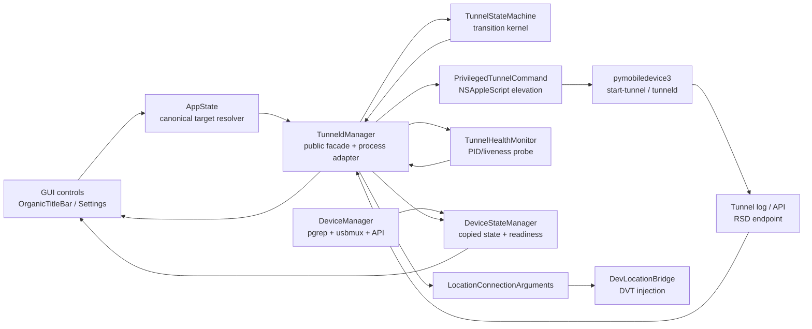
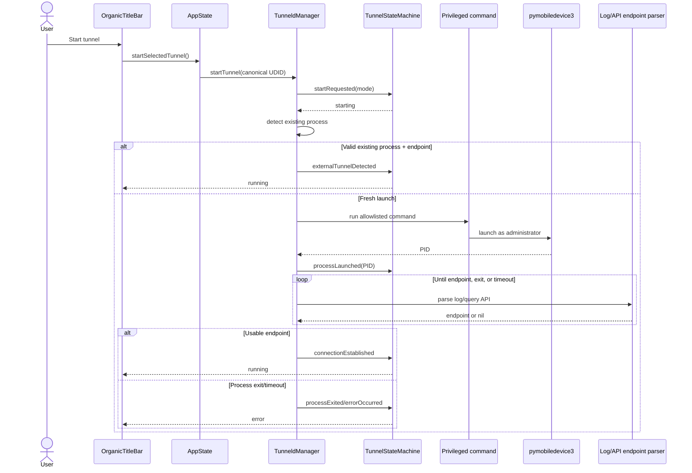
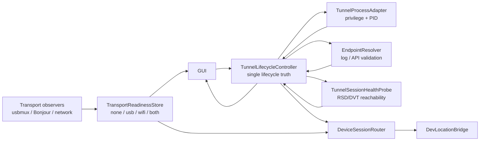

# Phase 1 — Tunnel Lifecycle Architecture and Data Flow

## Purpose

This document begins Phase 1 by mapping the tunnel subsystem before changing
its architecture. It covers:

- every component that observes or changes tunnel state,
- every GUI-to-process and process-to-GUI path,
- current lifecycle states and transitions,
- where transport readiness and tunnel lifecycle are conflated,
- the authoritative state boundaries required by Phase 1.

This is an architecture and data-flow deliverable. It does not implement the
target model.

## Architectural vocabulary

These concepts must remain distinct:

- **Device identity**: the canonical UDID for one physical iOS device.
- **Transport readiness**: whether that device is currently reachable over USB,
  Wi-Fi, both, or neither.
- **Tunnel process**: the privileged pymobiledevice3 child process.
- **Tunnel endpoint**: a validated RSD host/port or daemon tunnel lookup.
- **Tunnel lifecycle**: the user-visible start/active/degraded/stop state.
- **Device session**: the route that DVT/location injection currently uses.
- **Simulation session**: Teleport, Jump, Two-Spot, Multi-Spot, or Joystick
  state, independent of the transport carrying it.

A process existing does not prove a tunnel endpoint is usable. A transport
being ready does not mean a tunnel is active. A selected device does not prove
a session is connected.

## Current component map

### GUI and presentation

#### `OrganicTitleBar`

File: `PathChanger/UI/OrganicChrome.swift`

Responsibilities:

- displays the selected device,
- changes preferred USB/Wi-Fi connection mode,
- starts/stops the tunnel,
- renders the tunnel action from `TunneldManager.state`,
- reads direct readiness for help text.

Current tunnel action:

- idle → `Start tunnel`,
- starting → `Connecting…`,
- running → `Tunnel live`,
- error → `Tunnel error`,
- stopping currently falls through to `Start tunnel`.

The stopping presentation is incomplete.

#### `SettingsView`

File: `PathChanger/UI/SettingsView.swift`

Responsibilities:

- selects `TunnelMode`,
- starts and stops the tunnel,
- shows manager status/error/RSD details,
- exposes `autoStartTunneld`.

Its Start button calls `TunneldManager.startTunnel()` without passing the
selected canonical device ID. This differs from the title-bar path.

#### `DiagnosticsView`

File: `PathChanger/UI/DiagnosticsView.swift`

Responsibilities:

- reports tunnel status,
- directly constructs and runs a pymobiledevice3 DVT injection command.

It bypasses `DevLocationBridge`, so it does not exercise the same connection
selection, validation, held-process, or error-classification path used by the
main GUI.

### Application composition

#### `AppState`

File: `PathChanger/PathChangerApp.swift`

Responsibilities:

- resolves a canonical tunnel target ID,
- provides the title bar's selected-device tunnel start method,
- composes device, route, and simulation managers,
- stops tunnel-dependent simulations when tunnel state becomes inactive.

Important methods:

- `startSelectedTunnel()`
- `tunnelTargetDeviceId()`
- `checkTunneldStatus()`

#### `DeviceStateManager`

File: `PathChanger/Core/StateManagers/DeviceStateManager.swift`

Responsibilities:

- copies selected device and discovery state into GUI-facing properties,
- computes whether the selected device is ready,
- observes `TunneldManager.$state`,
- starts a five-second tunnel/transport polling loop,
- conditionally adopts externally running tunnels,
- exposes another `isTunneldRunning` property.

This is both a transport-readiness adapter and a duplicate tunnel-state cache.

### Tunnel lifecycle core

#### `TunnelStateMachine`

File: `PathChanger/Device/TunnelStateMachine.swift`

Current responsibility:

- validates lifecycle transitions,
- stores lifecycle context,
- records event/transition history,
- emits side-effect actions.

Current state:

- `idle`
- `starting`
- `running`
- `stopping`
- `error(String)`

Current context:

- active mode,
- tunnel endpoint,
- active process IDs,
- last error,
- retry count,
- recovering flag,
- last transition time,
- status message.

Current events:

- `startRequested`
- `processLaunched`
- `processExited`
- `connectionEstablished`
- `stopRequested`
- `processStopped`
- `errorOccurred`
- `healthCheckFailed`
- `recoveryAttempted`
- `connectionTimeout`
- `externalTunnelDetected`

Current actions:

- launch/terminate process,
- parse RSD info,
- start/stop health monitor,
- schedule recovery,
- log/notify,
- clean resources.

#### `TunneldManager`

File: `PathChanger/Device/TunneldManager.swift`

Current responsibility:

- singleton public tunnel API,
- owns `TunnelStateMachine`,
- mirrors state-machine context into `@Published` properties,
- chooses tunnel mode,
- checks for external processes with `pgrep`,
- constructs and runs privileged start/stop commands,
- tracks the launched PID,
- waits for a usable endpoint,
- parses the tunnel log,
- queries tunneld HTTP API,
- starts/stops health monitoring,
- provides DVT connection arguments.

It currently combines controller, process adapter, endpoint parser, reconciler,
read model, and public facade.

#### `TunnelHealthMonitor`

File: `PathChanger/Device/TunnelHealthMonitor.swift`

Current responsibility:

- runs every two seconds while the manager says running,
- verifies `tunnelInfo` exists,
- checks the process ID with `/bin/ps`,
- records local command latency as tunnel latency,
- emits degraded/critical health,
- recommends USB fallback,
- notifies `TunneldManager` after three consecutive failures.

Limitations:

- it does not probe the RSD endpoint,
- it does not run a DVT service probe,
- measured latency is local `ps` command latency,
- `recommendUSBFallback` is not a failover implementation.

### Process and privilege boundary

#### `PrivilegedTunnelCommand`

File: `PathChanger/Device/PrivilegedTunnelCommand.swift`

Responsibilities:

- allowlists exact tunnel start commands,
- permits a validated UDID suffix,
- allowlists Python paths,
- quotes paths and arguments,
- preserves the user's `HOME` so root can read user pairing records,
- redirects tunnel output to the user log,
- returns the launched PID,
- constructs PID-only stop commands.

#### `runAdministratorShell`

File: `PathChanger/Device/TunneldManager.swift`

Responsibility:

- executes the prevalidated command with macOS administrator privileges through
  `NSAppleScript`.

Result:

- success with shell output/PID,
- failure message,
- user cancellation.

### Process observation and discovery

#### `DeviceManager`

File: `PathChanger/Device/DeviceManager.swift`

Tunnel-related responsibilities:

- independently detects `start-tunnel` and `remote tunneld` with `pgrep`,
- publishes another `isTunneldRunning`,
- observes `TunneldManager.$state` for cache invalidation/refresh,
- discovers devices from tunneld HTTP API,
- reports direct USB/Network transport readiness.

This component observes both tunnel processes and transport availability. Those
facts are later copied into `DeviceStateManager`.

### Tunnel consumer

#### `LocationConnectionArguments`

File: `PathChanger/Device/LocationConnectionArguments.swift`

Selection:

- daemon tunneld → `--tunnel <UDID>`,
- valid RSD endpoint → `--rsd <HOST> <PORT>`,
- otherwise → `--udid <UDID>`.

#### `DevLocationBridge`

File: `PathChanger/Device/DevLocationBridge.swift`

Responsibilities:

- validates the device and coordinate,
- runs a DVT preflight,
- asks `TunneldManager` for connection arguments,
- starts/holds location simulation subprocesses,
- tracks whether the held process requires the tunnel,
- stops tunnel-dependent simulation when the tunnel is lost.

## Current data-flow overview

The problem visible in this graph is that both `TunneldManager` and
`DeviceManager` detect process truth, while both `TunneldManager` and
`DeviceStateManager` publish tunnel truth to the GUI.

## Current explicit-start data flow

### Title-bar path

1. User selects USB or Wi-Fi.
2. `DeviceManager.setConnectionMode` changes both discovery preference and
   `TunneldManager.preferredMode`.
3. User clicks **Start tunnel**.
4. `OrganicTitleBar` calls `AppState.startSelectedTunnel()`.
5. `AppState.tunnelTargetDeviceId()` resolves a canonical UDID.
6. `TunneldManager.startTunnel(deviceId:)` rejects duplicate active or
   transitioning starts.
7. Manager chooses modes:
   - selected specific mode, or
   - auto order: USB → Wi-Fi → daemon.
8. State machine receives `startRequested`:
   `idle → starting`.
9. Manager runs `detectRunningTunnel()` using `pgrep`.
10. If a process exists:
    - parse endpoint,
    - adopt only when endpoint is usable,
    - otherwise continue with a fresh launch.
11. `attemptStart` validates prerequisites:
    - USB mode requires USB usbmux visibility,
    - Python must be available,
    - command and paths must be allowlisted.
12. Manager creates/clears the tunnel log.
13. Administrator prompt runs the privileged command.
14. Manager parses or discovers the new PID.
15. State machine receives `processLaunched`; state remains `starting`.
16. Manager waits up to `min(AppSettings.tunnelTimeout, 30 seconds)`.
17. During the wait:
    - process existence is checked,
    - tunnel log is parsed,
    - tunneld HTTP API is queried.
18. Usable endpoint:
    - `connectionEstablished`
    - `starting → running`
    - health monitoring starts.
19. Process exit:
    - log is classified,
    - `processExited`
    - `starting → error`.
20. Timeout with live process:
    - `errorOccurred`
    - `starting → error`.

### Settings path divergence

`SettingsView` calls `TunneldManager.startTunnel()` directly. It bypasses
`AppState.tunnelTargetDeviceId()`, so selected-device targeting differs from the
title-bar path.

## Current adoption and app-relaunch flow

1. A privileged tunnel process may survive the GUI.
2. `DeviceStateManager` polls every five seconds.
3. `DeviceManager.checkTunneldStatus()` checks process patterns with `pgrep`.
4. If its copied process boolean is true and formal state is idle,
   `DeviceStateManager` asks `TunneldManager` to adopt.
5. Manager independently repeats process detection.
6. State machine temporarily enters `starting`.
7. Manager parses the existing tunnel log and discovers PID.
8. Adoption succeeds only with a usable endpoint.
9. Success sends `connectionEstablished`.
10. Missing endpoint sends terminal `errorOccurred`.

Current duplication:

- `DeviceManager` detects once,
- `TunneldManager` detects again,
- `DeviceStateManager` decides whether adoption is allowed.

## Current health and degradation flow

1. `connectionEstablished` emits `startHealthMonitor`.
2. `TunneldManager` installs the failure callback and starts monitoring.
3. Every two seconds `TunnelHealthMonitor`:
   - checks manager state,
   - checks endpoint presence,
   - runs `/bin/ps -p <PID>` when a PID exists,
   - records success and local process-command latency.
4. One/two failures:
   - monitor state becomes degraded,
   - lifecycle state remains running.
5. Three failures:
   - monitor state becomes critical,
   - `recommendUSBFallback = true`,
   - callback sends `healthCheckFailed`.
6. State machine transitions:
   `running → error`.
7. Manager stops monitor and cleans local resources.
8. There is no automatic reconnect or failover in this path.

Important mismatch:

- the TODO requires `degraded` and `reconnecting` to be first-class tunnel
  states,
- current degradation exists only inside `TunnelHealthMonitor`,
- the main lifecycle remains `running` until it jumps directly to `error`.

## Current stop data flow

1. User clicks **Tunnel live** or Settings **Stop Tunnel**.
2. `TunneldManager.stopTunnel()` sends `stopRequested`.
3. State becomes `stopping`.
4. Manager cancels monitoring.
5. Manager reads state-machine tracked PIDs.
6. `PrivilegedTunnelCommand.stopShellCommand` validates PIDs.
7. Administrator prompt runs TERM, waits, then KILL.
8. Manager also terminates its local `Process` reference if present.
9. Manager clears pipes, endpoint, and active mode.
10. State machine receives `processStopped`.
11. Context resets and state becomes `idle`.

Current idempotency:

- start ignores active/transitioning calls,
- stop from idle is ignored by the state machine,
- stop still performs local cleanup after an ignored event,
- stale async start completions do not carry an attempt/generation ID.

The last point means a prior attempt can theoretically report back after a newer
stop/restart cycle unless every individual state guard catches it.

## Current truth sources and duplicated state

### Formal lifecycle truth

`TunneldManager.state`, mirrored from `TunnelStateMachine.currentState`.

### Process-existence truth

Two independent implementations:

- `TunneldManager.detectRunningTunnel()`
- `DeviceManager.checkTunneldStatus()`

### GUI-facing copied truth

`DeviceStateManager.isTunneldRunning`.

It is written from:

- `TunneldManager.$state`,
- `DeviceManager.isTunneldRunning`.

### Endpoint truth

Duplicated between:

- `TunnelStateMachine.context.tunnelInfo`,
- `TunneldManager.tunnelInfo`,
- `TunneldManager.deviceTunnelInfo`.

### Mode/transport truth

Current values include:

- `DeviceManager.connectionMode`: user discovery preference,
- `TunneldManager.preferredMode`: user tunnel preference,
- `TunneldManager.activeMode`: declared active tunnel mode,
- `Device.connectionType`: one transport annotation,
- USB/Wi-Fi direct-device ID sets: observed readiness,
- USB/Wi-Fi aggregate booleans.

None is a complete representation of:

- both transports ready,
- actual tunnel transport,
- same-network availability,
- fallback readiness.

## Current-state ownership matrix

### `TunnelStateMachine`

Should own:

- lifecycle transition legality,
- active attempt/session identity,
- endpoint session,
- terminal failure.

Currently also owns:

- status copy,
- retry counters no longer connected to a valid privileged recovery path.

### `TunneldManager`

Should own:

- process and privilege side effects,
- translating process/endpoint observations into typed events.

Currently also owns:

- published state mirrors,
- endpoint caches,
- recovery policy,
- active mode read model,
- polling/reconciliation policy.

### `DeviceManager`

Should own:

- canonical device discovery,
- per-device transport observations.

Should not own:

- `isTunneldRunning`,
- tunnel-process reconciliation.

### `DeviceStateManager`

Should own or expose:

- selected device,
- derived GUI-ready device session information.

Should not own:

- a copied tunnel-running boolean,
- the decision to adopt a process.

### `TunnelHealthMonitor`

Should own:

- endpoint/session health observations and metrics.

Should not own:

- lifecycle policy,
- failover policy,
- a disconnected copy that competes with lifecycle state.

### GUI

Should:

- read lifecycle state for tunnel actions,
- read readiness state for transport indicators.

Should not:

- infer active state from transport presence,
- infer readiness from a tunnel process,
- choose between conflicting backend flags.

## Required Phase 1 state boundary

### Transport readiness state machine

Required public state:

- `none`
- `usbReady`
- `wifiReady`
- `bothReady`

Required context:

- canonical device UDID,
- observed transport set,
- USB observation timestamp,
- Wi-Fi observation timestamp,
- same-network status:
  - unknown,
  - same network,
  - different/no shared network with reason,
- preferred transport,
- fallback availability,
- observation confidence/source.

Allowed inputs:

- usbmux USB observations,
- usbmux Network observations,
- validated Bonjour observations,
- selected device changes,
- network-interface observations.

Forbidden inputs:

- `TunnelState.running`,
- process existence,
- RSD endpoint presence.

Readiness answers only:

> Which direct transports are currently available for this canonical device,
> and can one serve as fallback?

### Tunnel lifecycle state machine

Required public states:

- `idle`
- `starting`
- `active`
- `degraded`
- `reconnecting`
- `failed`
- `stopping`

Required context:

- canonical device UDID,
- attempt/session generation ID,
- requested mode,
- established active transport,
- tracked PID,
- validated endpoint,
- start/active timestamps,
- health snapshot,
- retry/backoff attempt,
- terminal failure with recovery guidance.

Required transitions:

- idle → starting: explicit user start.
- starting → active: process exists and endpoint is usable.
- starting → failed: cancellation, process exit, or timeout.
- active → degraded: endpoint/service health crosses degraded threshold.
- degraded → active: health recovers within grace window.
- degraded → reconnecting: recovery policy begins a real attempt.
- active → reconnecting: hard but recoverable interruption.
- reconnecting → active: a new validated session is established.
- reconnecting → failed: bounded attempts exhausted.
- active/degraded/reconnecting → stopping: explicit stop.
- starting → stopping: explicit cancellation/stop.
- stopping → idle: process/session teardown verified.
- failed → starting: explicit retry.
- failed → idle: clear/dismiss after teardown.

Forbidden transitions:

- process existence → active without endpoint validation,
- readiness → active,
- background poll → starting without a real launch/adoption attempt,
- stale async completion → any state on a newer generation.

## Required canonical session objects

### `TunnelAttempt`

Immutable identity for one startup/reconnect operation:

- generation UUID,
- canonical UDID,
- requested mode,
- trigger,
- start timestamp.

Every asynchronous callback must carry the generation and be ignored when it
does not match the current attempt.

### `TunnelSession`

Created only after validation:

- generation UUID,
- canonical UDID,
- active transport,
- mode,
- PID,
- usable endpoint,
- established timestamp.

This object is the proof behind the `active` state.

### `TransportReadinessSnapshot`

Independent of `TunnelSession`:

- canonical UDID,
- available transports,
- same-network state,
- fallback availability,
- timestamps/source.

### `DeviceSessionRoute`

Immutable routing decision consumed by `DevLocationBridge`:

- direct USB by UDID,
- direct Network by UDID,
- RSD endpoint,
- daemon tunnel by UDID.

The location bridge should receive this route rather than query several mutable
manager properties during command construction.

## Target Phase 1 component map

### Target responsibilities

#### `TransportReadinessStore`

- one per-device readiness source,
- no tunnel lifecycle fields,
- powers the separate readiness/status UI.

#### `TunnelLifecycleController`

- sole public tunnel state,
- accepts typed events,
- owns attempt/session generation,
- exposes derived action label and action availability.

#### `TunnelProcessAdapter`

- performs allowlisted elevation,
- launches/stops one attempt,
- reports PID and exit events,
- has no user-facing state.

#### `EndpointResolver`

- parses a candidate endpoint,
- validates reachability,
- returns a typed endpoint or failure,
- does not mutate lifecycle directly.

#### `TunnelSessionHealthProbe`

- probes endpoint and a minimal service,
- reports latency/health facts,
- does not choose fallback.

#### `DeviceSessionRouter`

- chooses direct USB, direct Wi-Fi, RSD, or daemon session,
- records the active route,
- is the later Phase 3 seam for failover,
- keeps simulation state independent.

## GUI data contract

### Tunnel action control

Reads only tunnel lifecycle:

- idle → **Start Tunnel**
- starting → **Starting…**
- active → **Stop Tunnel**
- degraded → **Stop Tunnel** plus warning
- reconnecting → **Reconnecting…** plus optional cancel
- failed → **Retry Tunnel**
- stopping → **Stopping…**

It never displays USB/Wi-Fi readiness.

### Separate transport indicator

Reads only transport readiness:

- **No transport**
- **USB Ready**
- **Wi-Fi Ready**
- **Both Ready**

Additional fields:

- active tunnel transport,
- same-network status,
- fallback available/unavailable and reason.

### Active-state invariant

The GUI may show active only when a `TunnelSession` exists with:

- matching canonical UDID,
- current generation,
- live tracked/adopted process,
- validated usable endpoint.

## Phase 1 implementation dependencies

1. Introduce typed readiness and tunnel attempt/session data structures.
2. Add generation identity to all asynchronous lifecycle events.
3. Make the state machine the only lifecycle publisher.
4. Remove decision use of `DeviceManager.isTunneldRunning`.
5. Stop copying lifecycle state into `DeviceStateManager`.
6. Move process/adoption reconciliation behind one controller event.
7. Replace process-only health with endpoint/service health.
8. Render transport readiness separately.
9. Route every Start Tunnel entry point through the same selected-device
   controller API.
10. Verify start, stop, restart, rapid presses, process exit, and relaunch
    adoption through the fresh dev GUI.

## Mapping result

The architectural root cause is confirmed:

- tunnel lifecycle is nominally modeled by `TunnelStateMachine`,
- but process existence, endpoint existence, readiness, copied running state,
  and user-facing status remain distributed across five components,
- those components publish overlapping truth on different schedules,
- GUI and injection consumers read different subsets.

Phase 1 should not add another boolean or another recovery timer. It must
centralize lifecycle transitions and separately model per-device transport
readiness.
