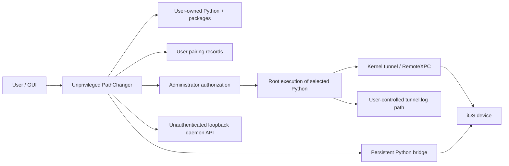

# Phase 4 — Tunnel Security and Reliability Audit

## Scope

This audit evaluates the Phase 3 tunnel modules M1–M13:

- canonical target resolution,
- transport readiness,
- dependency/capability preflight,
- strategy selection,
- lifecycle state,
- privileged process launch,
- endpoint acquisition,
- session publication,
- health observation,
- relaunch adoption,
- teardown,
- DVT session routing,
- GUI projection.

The audit combines:

- static code review,
- verified dependency/CLI behavior,
- runtime file ownership and permissions,
- live process/API state,
- current tests and their coverage.

No application behavior was changed.

## Runtime evidence

### Resolver-selected runtime

- Python path: `/opt/homebrew/bin/python3.13`
- Python version: `3.13.15`
- pymobiledevice3: `10.7.4`
- package location: `/opt/homebrew/lib/python3.13/site-packages`
- default remote-tunnel protocol: TCP

### Ownership

- `/opt/homebrew` is owned by the logged-in user.
- `/opt/homebrew/bin` is user-owned and group-writable.
- `/opt/homebrew/bin/python3.13` is a user-owned symbolic link.
- pymobiledevice3's package tree is user-owned.
- `/usr/bin/python3` is root-owned but is not the current resolver choice.

### Pairing files

- `~/.pymobiledevice3` permissions: `0755`
- pairing record permissions: `0644`
- records are owned by the logged-in user.

The audit did not read pairing-record contents.

### Tunnel log

- directory permissions: `0755`
- `tunnel.log` permissions: `0644`
- file is user-owned.

### Live process/API state

- no pymobiledevice3 tunnel process was active during the check,
- `127.0.0.1:49151` was not listening, which is correct while daemon mode is
  inactive.

## Trust boundaries

Critical boundary:

> Administrator approval currently promotes a user-owned Python interpreter and
> user-owned package tree into root execution.

## Security strengths

### SEC-STRENGTH-01 — Exact privileged command allowlist

`PrivilegedTunnelCommand` accepts only fixed tunnel start commands with an
optional validated UDID suffix.

### SEC-STRENGTH-02 — Fixed interpreter candidate policy

Arbitrary PATH-resolved Python and pyenv/virtualenv shims are not accepted.

This reduces accidental interpreter drift but does not make user-owned
Homebrew paths safe to elevate.

### SEC-STRENGTH-03 — Subprocess argument validation

Location commands use:

- coordinate range validation,
- UDID validation,
- flag/subcommand allowlists,
- RSD port checks,
- output-size limits.

### SEC-STRENGTH-04 — Environment cleanup

Unprivileged subprocesses remove:

- `PYTHONPATH`,
- `PYTHONHOME`,
- virtual-environment markers,
- `PIP_*`.

### SEC-STRENGTH-05 — Local-only daemon API default

The configured daemon endpoint is loopback-only.

### SEC-STRENGTH-06 — No optimistic active state

One-shot tunnel active state requires a nonempty endpoint and a valid port.

### SEC-STRENGTH-07 — Explicit-user privilege policy

Background health recovery no longer raises new administrator prompts or
silently loops through starting.

## Security findings

## SEC-TUN-01 — User-owned Python/package code executes as root

Severity: Critical  
Modules: M3, M6

### Evidence

- resolver selects user-owned `/opt/homebrew/bin/python3.13`,
- the path is a mutable symbolic link,
- `/opt/homebrew` and pymobiledevice3 are user-owned,
- `NSAppleScript` executes that path with administrator privileges.

### Impact

Any mutable Python/package startup code in that environment can execute with
root privileges after the user approves the prompt.

The risk includes:

- modified pymobiledevice3 modules,
- modified transitive dependencies,
- `.pth` startup hooks,
- `sitecustomize`,
- a changed Homebrew symlink/Cellar target.

String membership in the candidate-path allowlist does not verify:

- ownership,
- immutability,
- symlink target,
- code signature,
- package integrity.

### Required remediation

Preferred:

- use no-root userspace tunnels where supported.

If privileged tunneling remains necessary:

- replace AppleScript/root Python with a signed typed helper,
- use a root-owned verified runtime,
- do not import user-writable Python code at elevated privilege,
- verify executable identity and package integrity.

### Release gate

Do not ship the privileged tunnel path while this remains.

## SEC-TUN-02 — Root log redirection has a symlink/TOCTOU path

Severity: Critical  
Modules: M6, M7

### Evidence

1. App removes `tunnel.log`.
2. App creates it as the user.
3. Later, root shell executes:
   `... > user/path/tunnel.log 2>&1`.
4. Directory and file are user-writable/owned.
5. No `lstat`, `O_NOFOLLOW`, file descriptor handoff, or ownership validation
   protects the root open.

### Impact

The path can be swapped between user creation and root redirection. Root may
truncate/write a different target.

Moving from `/tmp` to `~/Library/Logs` reduces cross-user discovery but does not
remove a same-user race against root.

### Required remediation

- never let the root process open a user-controlled output path,
- capture stdout/stderr through pipes owned by the helper,
- or open a secure root-owned descriptor with no-follow and pass the descriptor,
- keep stdout and stderr separate.

### Release gate

Do not use the current root redirection path.

## SEC-TUN-03 — Pairing records are readable by other local users

Severity: High  
Modules: M2, M3

### Evidence

- directory: `0755`
- records: `0644`

### Impact

Pairing records can contain device trust/session material. Other local users
may be able to read the records and device identifiers.

This permission state is produced by the external tool, but PathChanger relies
on and exposes it.

### Required remediation

- require `0700` directory permissions,
- require `0600` pairing records,
- refuse or warn on broader permissions,
- do not print pairing material,
- treat pairing records as secrets.

## SEC-TUN-04 — Elevated PID termination does not verify process identity

Severity: High  
Modules: M6, M10, M11

### Evidence

- state stores numeric PIDs,
- stop validates only that each PID is greater than one,
- root sends TERM/KILL to those numbers,
- implementation does not verify owner, executable, arguments, start time, or
  generation immediately before termination.

The implementation comment claims ownership verification, but no such check is
present.

### Impact

If a tunnel process exits and its PID is reused, PathChanger can terminate an
unrelated process as root.

### Required remediation

- bind process identity to attempt generation,
- record PID plus start time/audit token,
- revalidate executable, target UDID, owner, and start identity in the helper,
- stop only helper-owned sessions.

## SEC-TUN-05 — Broad `pgrep` adoption can accept foreign processes

Severity: High  
Modules: M10

### Evidence

Adoption searches command lines with broad patterns.

### Impact

A process launched by:

- another app,
- another user,
- a shell,
- a different interpreter,
- a different target device

can be detected as a PathChanger tunnel.

Endpoint validation reduces false active state, but a foreign process plus a
matching/stale log can still influence adoption.

### Required remediation

- persist owned-session metadata,
- validate process identity and target,
- use a helper-issued session token,
- reject unowned processes by default.

## SEC-TUN-06 — Unpinned package upgrade enters privileged execution

Severity: High  
Modules: M3, M6

### Evidence

The GUI runs:

- `pip install --upgrade pymobiledevice3`
- latest version,
- no upper bound,
- no hashes/lock.

The installed package is later run as root.

### Impact

A dependency update changes privileged code without a PathChanger release.

### Required remediation

- lock the full dependency graph with hashes,
- define a tested version interval,
- never elevate runtime-installed user packages,
- add vulnerability and provenance checks.

## SEC-TUN-07 — Pairing-record HOME is exposed to elevated Python

Severity: High  
Modules: M3, M6

### Evidence

Elevated shell prefixes the user `HOME`.

### Impact

This fixes pairing-record discovery but also expands the elevated interpreter's
view of user-controlled startup/configuration files.

### Required remediation

- pass only the required pairing record through a typed helper interface,
- do not set root process HOME to the user's home,
- use least-privilege file access.

## SEC-TUN-08 — Tunnel/process logs expose identifiers and locations

Severity: Medium  
Modules: M7, M12, M13

### Evidence

- tunnel log is `0644`,
- security logging records complete command arguments,
- command metadata includes full UDIDs,
- location commands include coordinates,
- subprocess stdout/stderr excerpts are persisted.

### Impact

Other local users and support exports can receive:

- device identifiers,
- exact simulated locations,
- RSD endpoints,
- process diagnostics.

### Required remediation

- set log directory/file permissions to `0700/0600`,
- redact/hash UDIDs,
- reduce coordinate precision or omit coordinates,
- separate security events from sensitive payloads,
- define retention and export rules.

## SEC-TUN-09 — Loopback daemon API has no application authentication

Severity: Medium  
Modules: M7, M9, M12

### Evidence

`remote tunneld` binds loopback and exposes port 49151 without a PathChanger
session token.

### Impact

Other local processes can query or use the daemon API.

### Required remediation

- treat daemon as shared local infrastructure rather than owned private state,
- validate response schema and target,
- isolate with helper ownership where possible,
- do not expose sensitive details in the GUI/logs.

## SEC-TUN-10 — Persistent bridge validates coordinates but not connection fields

Severity: Medium  
Modules: M12

### Evidence

Python bridge checks:

- coordinate ranges,
- presence/type of UDID.

It does not enforce:

- UDID format,
- RSD address syntax,
- RSD port range.

### Impact

The Swift caller currently supplies validated internal values, but the Python
boundary has incomplete defense in depth.

### Required remediation

- validate UDID, address, and port in Python,
- version the JSON protocol,
- reject unknown fields/types,
- bound input line size.

## SEC-TUN-11 — Entitlement surface is broader than the tunnel need

Severity: Medium  
Modules: deployment boundary

### Evidence

Entitlements include:

- network client/server,
- USB,
- Bluetooth,
- location,
- broad selected/download file access.

No app sandbox entitlement is enabled.

### Impact

Tunnel code runs in a broadly capable unsandboxed application process.

### Required remediation

- separate tunnel helper responsibility,
- audit/remove unused capabilities,
- enable sandboxing where compatible,
- keep privilege in a narrow signed helper.

## SEC-TUN-12 — AppleScript command embedding is not a typed boundary

Severity: Medium  
Modules: M6

### Evidence

The code builds a shell command string, then embeds it in an AppleScript string.
Shell tokens reject single quotes, but the boundary is still string-based and
does not model typed arguments.

### Impact

Future dynamic values can create quoting/injection regressions even when the
current fixed values are constrained.

### Required remediation

- replace shell/AppleScript construction with a typed privileged protocol,
- pass structured arguments,
- enforce authorization in the helper.

## Reliability strengths

### REL-STRENGTH-01 — Stable terminal error after failed startup

Failed Wi-Fi startup no longer loops indefinitely through connecting.

### REL-STRENGTH-02 — Active requires usable endpoint

Missing address or port zero cannot become active.

### REL-STRENGTH-03 — Start guards reduce duplicate starts

Active/transitioning start calls are ignored.

### REL-STRENGTH-04 — Direct and tunnel-dependent held sessions are classified

Tunnel loss stops only sessions marked tunnel-dependent.

### REL-STRENGTH-05 — Rate limiting and queue strategies exist

Routes use sequential intent and joystick uses latest-wins intent.

## Reliability findings

## REL-TUN-01 — Persistent bridge ready wait can double-resume

Severity: Critical  
Modules: M12

### Evidence

`waitForReady()` starts:

1. a timeout task using `try? Task.sleep`,
2. a second task that sleeps 500 ms, cancels the timeout, and resumes true.

When the timeout task is cancelled, `try? Task.sleep` returns and execution
continues to resume false. The second task can then resume true.

### Impact

Checked continuation misuse can crash the app or produce nondeterministic bridge
startup.

The method also does not actually wait for the Python ready message.

### Required remediation

- use one actor-isolated continuation,
- cancellation must return before resuming,
- resume only from the decoded ready message or one timeout path,
- add exact-once tests.

## REL-TUN-02 — Persistent bridge supports only one pending request

Severity: Critical  
Modules: M12

### Evidence

`sendCommand` stores one `pendingContinuation`.

A second concurrent request overwrites the first continuation.

### Impact

Concurrent route/joystick/clear/stop operations can:

- resume the wrong caller,
- strand a continuation until timeout,
- misassociate responses,
- corrupt control flow.

Existing concurrent test usually calls `ping` while the bridge is not running,
so it does not exercise this path.

### Required remediation

- serialize requests through an actor/queue, or
- add request IDs and a continuation dictionary,
- test real concurrent requests against a deterministic fake process.

## REL-TUN-03 — State-machine side effects are not serialized across events

Severity: High  
Modules: M5

### Evidence

Each successful `send` creates a new unstructured `Task` for its action list.

### Impact

Actions from adjacent transitions can interleave:

- start parse after stop cleanup,
- monitor start after error,
- cleanup after a newer start,
- notification ordering drift.

### Required remediation

- serialize reducer events and effects in one actor,
- tie effects to generation,
- cancel obsolete effects.

## REL-TUN-04 — No attempt/session generation identity

Severity: High  
Modules: M5–M10

### Evidence

Async launch, endpoint polling, adoption, health, and cleanup callbacks carry no
generation ID.

### Impact

A stale completion can mutate a newer start/stop/restart cycle if current
state guards do not catch every timing.

### Required remediation

- introduce `TunnelAttempt` and `TunnelSession` generation UUIDs,
- require matching generation on all events,
- ignore/cancel obsolete work.

## REL-TUN-05 — Subprocess output can deadlock before size enforcement

Severity: High  
Modules: M3, M6, M12

### Evidence

Several subprocess paths:

1. attach pipes,
2. wait for process exit,
3. read pipe contents,
4. enforce output-size limit.

### Impact

If child output fills the OS pipe buffer, the child blocks before exit and the
parent waits for exit. The size limit is never reached.

### Required remediation

- drain stdout/stderr concurrently,
- enforce streaming byte limits,
- cancel/terminate on overflow,
- keep output channels separate.

## REL-TUN-06 — Health check does not measure tunnel health

Severity: High  
Modules: M9

### Evidence

Health success is:

- `tunnelInfo` exists,
- `/bin/ps -p PID` succeeds.

Latency is local `ps` command latency.

### Impact

An alive but unusable RemoteXPC session reports healthy. A missing/reused PID
can misreport failure/success. The `<50 ms` metric has no relationship to DVT
latency.

### Required remediation

- probe endpoint connectivity,
- probe a minimal RemoteXPC/DVT service,
- separate process, endpoint, and service health.

## REL-TUN-07 — Degraded and reconnecting are not lifecycle states

Severity: High  
Modules: M5, M9, M13

### Evidence

- monitor can say degraded,
- lifecycle remains running,
- after three failures lifecycle jumps directly to error,
- reconnecting fields/events remain disconnected from a real launch.

### Impact

GUI cannot show truthful degradation/reconnect progress, and failover cannot
consume a stable state transition.

### Required remediation

- implement the Phase 1 seven-state lifecycle,
- attach bounded real reconnection attempts,
- expose degradation to GUI.

## REL-TUN-08 — Daemon and one-shot modes use incompatible success models

Severity: High  
Modules: M7, M8

### Evidence

- one-shot tunnel returns one HOST/PORT,
- daemon exposes an API and per-device routes,
- manager API query does not populate `deviceTunnelInfo`,
- startup waiter still expects single `tunnelInfo`.

### Impact

A healthy daemon can fail startup validation or cannot provide per-device route
state to the manager.

### Required remediation

- define separate one-shot and daemon session validators,
- populate and validate target UDID route,
- health-check daemon/API separately.

## REL-TUN-09 — Human log parsing is fragile and noisy

Severity: High  
Modules: M7

### Evidence

- stdout/stderr are merged,
- formatted messages and warnings are parsed,
- installed CLI provides `--script-mode`,
- daemon API is queried during one-shot modes.

### Impact

Warning/output changes can cause false timeout; expected API refusal obscures
the real error.

### Required remediation

- use script-mode stdout,
- separate stderr,
- mode-specific endpoint acquisition.

## REL-TUN-10 — Adoption depends on duplicate process detection and shared log

Severity: High  
Modules: M10

### Evidence

- DeviceManager runs pgrep,
- TunneldManager repeats pgrep,
- adoption parses a shared log path,
- no persisted attempt/session metadata exists.

### Impact

Relaunch can adopt the wrong process or reject a valid one due to stale/missing
log state.

### Required remediation

- persist owned-session metadata,
- validate generation/process identity/target/endpoint,
- reconcile in one controller.

## REL-TUN-11 — Stop does not prove clean teardown

Severity: Medium-High  
Modules: M11

### Evidence

- sends TERM,
- waits 0.2 seconds,
- unconditionally sends KILL,
- clears state immediately,
- does not verify process/port/API/socket release.

### Impact

- false stop error when TERM already succeeded,
- leaked process/interface/port,
- GUI idle while resources survive.

### Required remediation

- wait boundedly for graceful exit,
- KILL only when still alive,
- verify process identity and resource release,
- return a teardown report.

## REL-TUN-12 — Privileged commands block the main actor

Severity: Medium-High  
Modules: M6, M11, M13

### Evidence

`NSAppleScript.executeAndReturnError` is invoked from the main-actor manager.

### Impact

GUI can freeze while:

- authorization is pending,
- shell command launches,
- stop command sleeps/completes.

### Required remediation

- execute privilege workflow outside UI isolation,
- return typed progress/results to the main actor.

## REL-TUN-13 — Duplicate application termination teardown

Severity: Medium  
Modules: M11

### Evidence

Both:

- TunneldManager's notification observer,
- `AppDelegate.applicationWillTerminate`

call `stopTunnel()`.

### Impact

Duplicate state events, cleanup, and administrator stop prompts can occur.

### Required remediation

- one lifecycle owner handles termination,
- teardown is idempotent and generation-scoped.

## REL-TUN-14 — Recovery transition can enter starting without launching

Severity: Medium  
Modules: M5, M6

### Evidence

- `recoveryAttempted` can transition error → starting,
- it emits `launchProcess`,
- `TunneldManager.handleStateMachineAction(.launchProcess)` is a no-op.

Current production paths no longer schedule this automatically, but the invalid
transition remains callable.

### Impact

Future recovery wiring can recreate the permanent Connecting state.

### Required remediation

- remove dead recovery transition or connect it to a real generation-scoped
  launch effect,
- test recovery end to end.

## REL-TUN-15 — Error detail is overwritten by generic process exit

Severity: Medium  
Modules: M5, M7, M13

### Evidence

Log classification can identify pairing/device/timeout failure, but
`processExited` stores generic `Tunnel process exited`.

### Impact

GUI loses actionable root cause.

### Required remediation

- carry typed `TunnelFailure`,
- preserve stage, diagnostic, recovery action, and public message.

## REL-TUN-16 — Standard and persistent connection capabilities diverge

Severity: Medium-High  
Modules: M3, M12

### Evidence

- standard CLI can establish userspace RSD automatically,
- persistent bridge does not use `UserspaceRsdTunnel`,
- persistent failure silently falls back to subprocess.

### Impact

Teleport can work while route/joystick degrades, stutters, or repeatedly
rebuilds processes without explaining the capability difference.

### Required remediation

- model capability per operation,
- implement userspace RSD in persistent bridge or explicitly require external
  RSD for high-frequency modes,
- surface fallback/degraded mode.

## REL-TUN-17 — Held subprocess output is not drained after ownership transfer

Severity: Medium  
Modules: M12

### Evidence

Keep-alive simulate-location process is retained after initial wait, while its
stdout/stderr pipes have no ongoing readers.

### Impact

Unexpected continuing output can fill buffers and stall the held session.

### Required remediation

- install bounded streaming readers for retained processes,
- retain process plus pipe-reader lifecycle as one session object.

## REL-TUN-18 — Auto-start can mark foreign process active without endpoint

Severity: Medium  
Modules: M5, M10

### Evidence

`autoStart()` sends `externalTunnelDetected` directly when pgrep finds a match.
That transition moves idle → running before endpoint validation.

Application-launch policy currently prevents this path from elevating, but the
public method remains unsafe if called.

### Required remediation

- route all auto-start behavior through validated adoption,
- remove direct external-process-to-running transition.

## REL-TUN-19 — Current tests do not exercise critical failure paths

Severity: High verification gap  
Modules: all

### Evidence

Persistent bridge tests mostly validate:

- error text,
- singleton identity,
- no-op ping while not running,
- script syntax.

The concurrent test does not run a live/fake bridge request pipeline.

Privileged tests validate:

- generated strings,
- simple PID number constraints.

Missing tests include:

- ready continuation exact-once,
- concurrent response correlation,
- state-effect ordering,
- stale generation rejection,
- symlink-safe output,
- PID identity/reuse,
- daemon success model,
- endpoint health,
- double termination,
- teardown resource proof.

### Required remediation

- add deterministic fakes for process, endpoint, helper, and bridge transport,
- run hardware integration separately,
- do not infer safety from the overall green unit count.

## Module risk map

### M1 — Identity

- raw-ID fallback remains possible,
- process/adoption target is not cryptographically/structurally bound.

### M2 — Readiness

- same-network and fallback truth absent,
- pairing permissions unsafe.

### M3 — Capability

- no elevated-runtime integrity check,
- unpinned package graph,
- operation capability mismatch.

### M4 — Strategy

- userspace vs privileged decision not explicit,
- protocol depends on interpreter.

### M5 — Lifecycle

- unstructured effects,
- no generation,
- incomplete states,
- unsafe recovery transition.

### M6 — Privileged launch

- user-owned code as root,
- AppleScript string boundary,
- root log race.

### M7 — Endpoint

- free-form parsing,
- merged channels,
- mode mismatch.

### M8 — Session

- duplicated mutable endpoint/session state.

### M9 — Health

- process lookup only,
- false latency semantics.

### M10 — Adoption

- pgrep spoofing/foreign process,
- stale log,
- no ownership token.

### M11 — Teardown

- PID reuse,
- unconditional KILL,
- duplicate termination handlers,
- no resource proof.

### M12 — Routing/bridge

- continuation and concurrency defects,
- incomplete Python validation,
- userspace capability mismatch,
- pipe draining.

### M13 — GUI

- blocking privilege work,
- copied/divergent state,
- error specificity loss.

## Prioritized remediation

## P0 — Block privileged-release risk

1. Stop elevating user-owned Python/packages.
2. Remove root redirection into user-controlled paths.
3. Replace PID-only stop with helper-owned process identity.
4. Restrict pairing directory/records to `0700/0600`.
5. Pin and verify the dependency graph.

## P0 — Fix deterministic crash/hang risks

1. Rewrite persistent bridge ready wait for exact-once continuation.
2. Serialize or correlate bridge requests.
3. Drain subprocess pipes concurrently with output limits.
4. Add generation identity to lifecycle effects.
5. Serialize state-machine effects.

## P1 — Make lifecycle truth reliable

1. Implement active/degraded/reconnecting/failed states.
2. Separate daemon and one-shot success models.
3. Use script-mode output and mode-specific API behavior.
4. Replace process health with endpoint/service health.
5. Persist owned session metadata for adoption.
6. Produce verified teardown reports.

## P1 — Make capabilities explicit

1. Model standard CLI userspace support.
2. Model persistent bridge RSD requirement.
3. Pin protocol.
4. Bundle the bridge resource consistently.
5. Run every GUI entry through one capability preflight.

## P2 — Reduce exposure and improve diagnostics

1. Redact identifiers/coordinates.
2. Harden log permissions/retention.
3. Remove unused entitlements and legacy surfaces.
4. Replace string errors with typed failure records.
5. Add full deterministic and hardware integration coverage.

## Required verification gates

### Security gates

- elevated helper executes no user-writable code,
- symlink/canary log test cannot modify an arbitrary target,
- pairing permissions are private,
- PID reuse test cannot stop unrelated process,
- foreign pgrep process is never adopted,
- locked dependency verification passes,
- logs contain no full UDIDs/coordinates.

### Reliability gates

- continuation exact-once stress test,
- concurrent bridge request correlation test,
- rapid start/stop/restart with stale callbacks,
- daemon start and target-route verification,
- process alive but endpoint dead test,
- graceful TERM and forced-KILL branches,
- app termination causes one teardown,
- route/joystick capability degradation is visible,
- no process/port/task leak after repeated cycles.

### GUI gates

- all privilege work leaves UI responsive,
- active appears only with validated session,
- degraded/reconnecting/failed are visible,
- actionable root cause survives propagation,
- readiness is separate from lifecycle.

## Release assessment

Current status:

- **Security: not production-safe for privileged tunneling**
- **Reliability: not ready for end-to-end tunnel/failover certification**

The current stable-error and deduplication fixes improve honesty, but they do
not address the privilege and concurrency defects above.

The safest architectural direction for the current iOS 27 target is:

1. prefer no-root userspace tunnels for operations that support them,
2. implement a safe persistent userspace route where practical,
3. use a signed, typed, root-owned helper only for capabilities that truly
   require privileged kernel tunneling.
